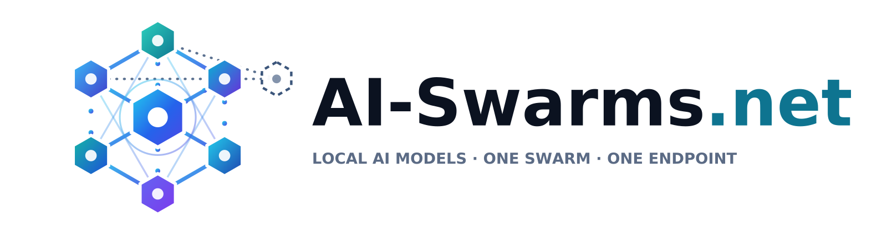

<h1 align="center">
  <picture>
    <source media="(prefers-color-scheme: dark)" srcset="../logos/png/ai-swarms-net-dark.png">
    
  </picture>
</h1>

[English](../README.md) · **Deutsch**

**Lokale KI-Modelle bilden ein Team.** AI-Swarms.net verbindet die Rechner, auf denen Sie Modelle mit Ollama, llama.cpp, vLLM oder LM Studio betreiben, zu einem Schwarm. Für jede Anfrage stellt er ein Team zusammen: Ein Modell entwirft, ein Modell einer anderen Familie prüft, und nur bei Mängeln wird nachgebessert. Ihre Anwendungen sprechen mit dem Schwarm wie mit einem einzelnen OpenAI-Endpunkt.

> **Status: Forschungsprototyp.** Der lokale Schwarm sowie private Netze, Gruppennetze und das offene Netz laufen auf echter Hardware über mehrere Standorte. Ob der Schwarm bessere Antworten liefert als das beste Einzelmodell, ist noch nicht belegt. Protokoll in Version 0.1, inkompatible Änderungen sind möglich. Details: [Stand](../docs/de/status.md).

## Was es kann

- **Ein Endpunkt für alle Modelle:** OpenAI-kompatible API auf `http://127.0.0.1:7711/v1` für Open WebUI, IDEs und Coding-Agenten, auch mit Werkzeug-Aufrufen.
- **Zusammenarbeit nach Muster:** bester Spezialist, mehrere Modelle parallel mit Synthese oder Entwurf mit Prüfung durch eine andere Modellfamilie. Die Antwort zeigt, welches Modell was beigetragen hat.
- **Drei Netzarten:**
  - **Privates Netz** für die eigenen Geräte, abgeschlossen mit einem gemeinsamen Schlüssel.
  - **Gruppennetz** für Vereine, Teams und Firmen: Zertifikat je Knoten, Mitglieder per Einladungslink aufnehmen und einzeln in Sekunden entfernen, ohne zentralen Server.
  - **Offenes Netz** für alle, mit eingeschränkten Rechten für Fremde.
- **Über Standorte hinweg:** Knoten hinter NAT, CGNAT oder DS-Lite finden sich ohne offene Ports, direkt, per Hole Punching oder über einen Helfer.
- **Ihre Daten bleiben bei Ihnen:** Sie legen je Anfrage fest, wer sie sehen darf (nur lokal, vertraute Geräte, öffentlich). Welche Werkzeuge fremde Modelle sehen, bestimmen Sie je Netz.
- **Ihre Hardware bleibt Ihre:** Eigene Anfragen haben Vorrang. Für andere rechnet ein Knoten nur, wenn Sie es einschalten, und nur in Zeitfenstern, unter GPU- und Temperaturgrenzen oder bei PV-Überschuss.

## Schnellstart

Voraussetzungen: ein laufender Inferenz-Server mit OpenAI-kompatibler API, z. B. Ollama. Ab Version 0.4.0 enthalten die [Releases](https://github.com/rainer-sharp/Ai-Swarms.net/releases) das Programm fertig für Linux, macOS und Windows ([Installation](../docs/de/installation.md#fertige-programmdateien)); selbst bauen braucht Go 1.27:

```sh
git clone https://github.com/rainer-sharp/Ai-Swarms.net.git
cd Ai-Swarms.net
go build -o swarmainet ./cmd/swarmainet

./swarmainet init                    # legt ~/.swarmainet/config.yaml und ein eigenes privates Netz an
$EDITOR ~/.swarmainet/config.yaml    # Modelle unter backends eintragen
./swarmainet run
```

Ein Beispiel für den Abschnitt `backends` mit zwei Modellfamilien steht in [`config.example.yaml`](../config.example.yaml). Danach:

```sh
curl -s http://127.0.0.1:7711/v1/chat/completions -H 'Content-Type: application/json' \
  -d '{"model":"swarmainet","messages":[{"role":"user","content":"Was ist ein Primzahlsieb?"}]}'
```

Oder in Open WebUI unter *Einstellungen → Verbindungen* die URL `http://127.0.0.1:7711/v1` eintragen und das Modell `swarmainet` wählen.

> `init` richtet ein **eigenes privates Netz** mit frischem Schlüssel ein: Nur Ihre Geräte, die Sie einladen, sehen den Knoten. Für das offene Netz stattdessen `swarmainet init -open`; dort ist der Knoten für andere mit Peer-ID und Adresse sichtbar, nimmt aber keine fremden Aufträge an, bis Sie das einschalten ([Netzarten](../docs/de/networks.md)).

**Weitere Geräte verbinden:** Auf einem laufenden Knoten `swarmainet invite -with-key` aufrufen und auf dem neuen Gerät `swarmainet join '<link>'`. Im LAN finden sich die Geräte danach selbst; für mehrere Standorte siehe [Netzarten](../docs/de/networks.md#mehrere-standorte).

## Dokumentation

| | |
|---|---|
| [Installation](../docs/de/installation.md) | Bauen, Einrichten, Dauerbetrieb unter Linux und Docker |
| [Nutzung](../docs/de/usage.md) | Modellnamen und Muster, Open WebUI, Coding-Agenten, Befehle, Diagnose |
| [Netzarten](../docs/de/networks.md) | Privates Netz, Gruppennetz, offenes Netz, mehrere Standorte, Helfer |
| [Konfiguration](../docs/de/configuration.md) | Alle Schlüssel und Dateien |
| [Stand](../docs/de/status.md) | Was erprobt ist, was fehlt |
| [Gesamtkonzept](../docs/de/concept.md) | Vision, Entscheidungen, Rollen, Vertrauen, Roadmap |
| [Spezifikation](../spec/de/README.md) | Protokoll, Netzschicht, Sicherheitsmodell |
| [Änderungen](CHANGELOG.md) | Änderungen je Version |

## Sicherheit

AI-Swarms.net ist nicht auditiert. Geben Sie vertrauliche Inhalte nur an eigene Geräte oder Mitglieder eines Gruppennetzes. Im offenen Netz sehen fremde Knoten, was Sie als `public` senden. Schwachstellen bitte nicht öffentlich melden, sondern wie in [SECURITY.md](SECURITY.md) beschrieben.

## Mitwirken

Fehlerberichte, Messungen mit anderen Modellen und Erfahrungen aus anderen Netzen sind willkommen, siehe [CONTRIBUTING.md](CONTRIBUTING.md). Beiträge sind unter den Lizenzen des Projekts willkommen, mit einem Sign-off nach dem [Developer Certificate of Origin](../DCO).

## Lizenz

AI-Swarms.net ist ein Community-Projekt und freie Software unter der [GNU AGPL-3.0-or-later](../LICENSE). Wer es verändert und weitergibt oder als Dienst im Netz anbietet, muss den Quellcode offenlegen.

Die Dokumentation und die Spezifikation stehen unter [CC BY 4.0](../LICENSE-DOCS), Abgrenzung siehe [LICENSING.md](LICENSING.md).

Die Benchmark-Aufgaben in `bench/` stammen aus HumanEval und GSM8K (© OpenAI, MIT).
