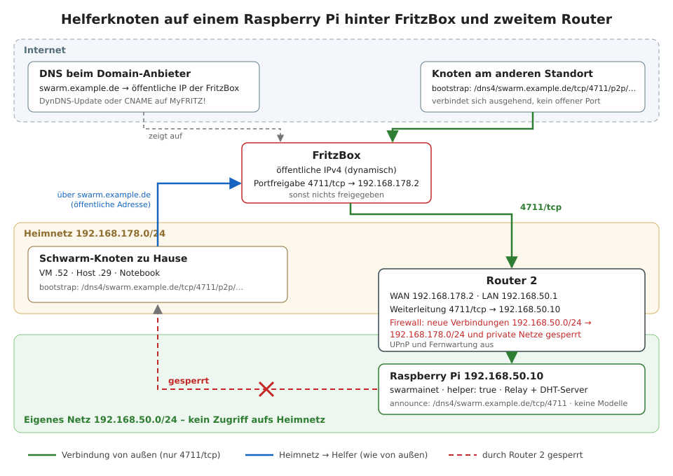

# Helper node on a Raspberry Pi

**English** · [Deutsch](de/README.md)

This guide sets up a **helper node** ([spec/p2p-layer.md](../../spec/p2p-layer.md) § 6.1) on a Raspberry Pi 4. The sites of a private swarm connect through it. The Pi does not compute, accepts no tasks and knows no models; it is entry point, DHT server and relay. All other nodes connect to it **outgoing** and need no port forwarding.

There is a target setup and two test environments that can already be built now:

| Setup | Role of the Pi | reachable from outside | Sections |
|---|---|---|---|
| **Target setup:** your own FritzBox, router 2, Pi | helper, isolated from the home network | IPv4 via two port forwardings | 1–4, 7–8 |
| **Test A:** another FritzBox with a cable connection | helper | IPv4 port forwarding, with DS-Lite an IPv6 forwarding | 1–3, 5, 7–8 |
| **Test B:** mobile router ZTE MF79U with O2 | helper only via IPv6, otherwise a node behind CGNAT | IPv4 never, IPv6 maybe | 1–3, 6–8 |

**Target setup** (diagram labels in German):



**Test environments:**


In all cases:

- At most **one port** is reachable from outside: 4711/tcp.
- Because of the network key (PSK), not even the connection setup succeeds without the key. For strangers the port is only noise.

## 1. What you need

| | |
|---|---|
| Raspberry Pi | **Pi 4** with 2 GB RAM or more (Pi 3 and 5 work as well), USB-C power supply 5.1 V / 3 A, network cable, case with cooling |
| Memory card | microSD from 16 GB, class A1 or A2, plus a card reader on the PC |
| Operating system | **Raspberry Pi OS Lite (64-bit)**, currently based on Debian 13 "Trixie". The Lite variant has no desktop, which the helper does not need. |
| Development computer | with Go (to build swarmainet) and an SSH key |
| Domain | a domain of your own with manageable DNS (target setup; in the tests a MyFRITZ! name is often sufficient) |

Example values follow: home network `192.168.178.0/24`, name `swarm.example.de`, host name of the Pi `swarm-helper`, user `admin`. Replace them with yours.

## 2. Preparing the Raspberry Pi 4

Best set up the Pi **at home**, on your own network and headless via SSH. Then it goes to its place of use.

### 2.1 SSH key

If you do not have one on the development computer yet:

```sh
ssh-keygen -t ed25519 -C "swarm-helper"
cat ~/.ssh/id_ed25519.pub        # the Imager needs this line in a moment
```

### 2.2 Writing the image to the card

1. Install **Raspberry Pi Imager version 2 or later** from [raspberrypi.com/software](https://www.raspberrypi.com/software/) (on Linux as an AppImage). **Not** the package `rpi-imager` from Ubuntu or Debian: it is version 1.8 and too old for the current Raspberry Pi OS. It does write the image, but the customisations from step 3 (host name, user, SSH, key) do not arrive.
2. Start the Imager and choose one after the other:
   - **Device:** Raspberry Pi 4
   - **Operating system:** *Raspberry Pi OS (other)* → **Raspberry Pi OS Lite (64-bit)**
   - **Storage:** the microSD card (everything on it will be deleted)
3. **Customise** (the Imager then asks whether the settings should be applied):
   - Host name: `swarm-helper`
   - User and password: a user of your own, e.g. `admin`, with a strong password
   - Time zone, keyboard layout as appropriate
   - **Wi-Fi only for test B**, if the Pi is connected to the stick via Wi-Fi instead of USB (section 6); otherwise leave empty
   - **Enable SSH**, "Allow public-key authentication only", and enter the content of `id_ed25519.pub`
4. Let it write. The Imager verifies the image itself after writing.

### 2.3 First start

1. Card into the Pi, network cable to the FritzBox at home, connect the power supply. The first start takes one to two minutes.
2. Log in:
   ```sh
   ssh admin@swarm-helper.local
   ```
   If the name does not work, the address is listed in the FritzBox under *Home Network → Network*.
3. Update and enable automatic security updates:
   ```sh
   sudo apt update && sudo apt full-upgrade -y
   sudo apt install -y unattended-upgrades
   sudo reboot
   ```

### 2.4 If the Pi cannot be reached

- **Not on the network, not in the FritzBox:** watch the LEDs. Red permanently on means power is fine; green flickers during start and is then mostly off, which is normal. A regularly repeated blink pattern of the green LED means the Pi finds no bootable system: write the card again. **If the LEDs at the network socket stay dark, first swap the cable** for one that demonstrably works on another device, and use another port on the FritzBox. Some cases have their own power button (e.g. Argon ONE); without pressing it the Pi does not start.
- **On the network, but not as `swarm-helper.local` and without SSH:** then the Imager did not apply the customisations, usually because of a too old version (step 2.2). Recognisable by the Pi asking for keyboard and user on the first start when a monitor is attached. Catch up on the Pi with monitor and keyboard:
  ```sh
  sudo hostnamectl set-hostname swarm-helper
  sudo sed -i 's/raspberrypi/swarm-helper/g' /etc/hosts
  sudo systemctl enable --now ssh
  ```
  Then transfer the key on the development computer and check the login:
  ```sh
  ssh-copy-id admin@<address of the Pi>
  ssh admin@<address of the Pi>          # must work without a password
  ```
  Only then switch off password login on the Pi:
  ```sh
  echo "PasswordAuthentication no" | sudo tee /etc/ssh/sshd_config.d/10-nur-schluessel.conf
  sudo systemctl restart ssh
  ```

## 3. Installing swarmainet

1. **Build** on the development computer in the project directory and copy to the Pi:
   ```sh
   CGO_ENABLED=0 GOOS=linux GOARCH=arm64 go build -trimpath -o swarmainet-arm64 ./cmd/swarmainet
   scp swarmainet-arm64 deploy/raspberry-pi/{install.sh,config.yaml,swarmainet.service} admin@swarm-helper.local:
   ```
2. **Install** on the Pi:
   ```sh
   sudo sh install.sh
   ```
   The script creates the system user `swarmainet`, the data directory `/var/lib/swarmainet` (mode 0700), the configuration from the template and the service (hardened systemd unit, starts with the system). It does not start it yet. On later runs it only replaces the program; configuration and keys are kept.
3. **Join the network:** create an invitation on a node of the swarm at home:
   ```sh
   swarmainet invite -with-key
   ```
   and join with it on the Pi:
   ```sh
   sudo -u swarmainet swarmainet join -config /var/lib/swarmainet/config.yaml '<link>'
   ```
   `join` enters network ID and key. The link contains the network key: only transfer it confidentially, e.g. via SSH, and do not keep it afterwards.
4. **Enter the public name:**
   ```sh
   sudoedit /var/lib/swarmainet/config.yaml
   ```
   Under `announce`, the name under which the Pi is reachable at its place of use (section 4, 5 or 6), e.g. `/dns/swarm.example.de/tcp/4711`. As long as the Pi is running at home for trying things out or the name does not yet point to the place of use, `announce: []` stays empty. Best use a subdomain of its own for the helper (e.g. `helper.<your-domain>`), so that the main domain stays free, e.g. for a website. Without `announce`, the Pi only knows its local address, and nobody outside can do anything with it. `/dns/` resolves A and AAAA records, i.e. IPv4 and IPv6.
5. **Restart and note the peer ID.** The service starts on its own after every boot, so it may already be running with the old configuration; it only reads changes on restart. Therefore always `restart`, not `start`:
   ```sh
   sudo systemctl restart swarmainet
   journalctl -u swarmainet -f                     # log, Ctrl+C ends it
   sudo -u swarmainet swarmainet status -config /var/lib/swarmainet/config.yaml | grep -m1 peer_id
   ```
6. Shut down the Pi (`sudo poweroff`) and take it to its place of use.

**Updating:** copy a new `swarmainet-arm64` and run `sudo sh install.sh` again; the service is restarted in the process.

**Alternative with Docker:** the helper also runs in a container ([deploy/docker](../docker/compose.yaml)), the image builds for arm64 on the Pi. Natively with systemd needs less memory and is the simpler choice on the Pi.

## 4. Target setup: FritzBox, router 2 and DNS

Here the Pi sits behind a second router that isolates it from the home network. Example values: router 2 with WAN `192.168.178.2` and LAN `192.168.50.0/24`, Pi `192.168.50.10`.

### 4.1 DNS record instead of domain forwarding

The "domain forwarding" of many providers is an **HTTP redirect**: a web server of the provider sends browsers on to another address. That is useless for libp2p, because the node does not speak HTTP. What is needed is a **DNS record** that makes `swarm.example.de` point to the current IPv4 address of the FritzBox:

- **A record via DynDNS**, if the provider offers an update URL. In the FritzBox under *Internet → Permit Access → DynDNS*, enable "Use DynDNS", choose "User-defined" and enter the provider's update URL, domain name, user and password.
- **CNAME to MyFRITZ!**: set up a MyFRITZ! account in the FritzBox (*Internet → MyFRITZ! Account*). The FritzBox gets a name like `xxxxxxxx.myfritz.net` that follows it automatically. At the domain provider, make `swarm.example.de` a CNAME pointing to it.

The TTL of the record should be short, e.g. 300 s. **There is no port filter in DNS**: DNS only maps names to addresses and sees neither ports nor traffic. Filtering happens in the FritzBox and router 2.

Some providers call this "DNS forwarding". Whether it fits shows in the result:

```sh
dig +short swarm.example.de     # must return the public IPv4 of the FritzBox
```

- If the IPv4 of the FritzBox appears (*Internet → Online Monitor*), alone or under a MyFRITZ! name, everything is right.
- If an IP of the domain provider appears, it is an HTTP redirect; port 4711 will then never arrive at the FritzBox.
- The record must follow the **changing** IP. To test, *Internet → Online Monitor → Reconnect* and repeat `dig` after a few minutes.

### 4.2 FritzBox

1. **Check the public IPv4:** *Internet → Online Monitor*. If it says "DS-Lite" or there is no IPv4 address of your own, an IPv4 forwarding will never arrive; see section 9.
2. **Give router 2 a fixed address:** *Home Network → Network → Network Connections*, edit router 2, "Always assign this network device the same IPv4 address", e.g. `192.168.178.2`.
3. **Port forwarding only to router 2:** *Internet → Permit Access → Port Sharing → Add Device for Sharing*, choose router 2, then *New Sharing → Port Sharing*: "Other application", name `swarmainet`, protocol **TCP**, port to device **4711** to 4711, external port **4711**, "Enable sharing for IPv4".
4. Do **not** enable "Allow automatic port forwarding" and **not** "Exposed Host" for router 2.

(Menu names of the FritzBox user interface are translated here and may differ slightly in your language version.)

### 4.3 Router 2

The menus have different names with every manufacturer. What to set:

1. **WAN** on the LAN port of the FritzBox, address `192.168.178.2`.
2. **LAN** as a network of its own, e.g. `192.168.50.1/24`; always give the Pi `192.168.50.10` via a DHCP reservation.
3. **Port forwarding** WAN 4711/tcp → `192.168.50.10:4711`.
4. **Firewall, and this is the most important point:** without a rule, the Pi reaches the home network, because router 2 forwards everything to the FritzBox. Therefore block **new connections from the LAN of router 2** to all private networks except its own:
   - destination `192.168.178.0/24` (home network): block
   - destination `10.0.0.0/8`, `172.16.0.0/12` and `192.168.0.0/16` except `192.168.50.0/24`: block
   - everything else (internet): allow

   **Replies must get through:** if a node from the home network connects to the Pi, the Pi's replies go to an address in the home network. The rule may therefore only block **new** connections; existing and related ones (*established*/*related*) must remain allowed. With OpenWrt this is a rule in the *forward* chain with the state `NEW`.
5. Switch off **UPnP**, **remote maintenance** and **WPS**, set an admin password of your own.

Check from the Pi:

```sh
ping -c1 1.1.1.1            # internet: must work
ping -c1 192.168.178.29     # a device in the home network: must fail
```

`announce` in the Pi configuration: `/dns/swarm.example.de/tcp/4711`.

## 5. Test environment A: another FritzBox with a cable connection

The Pi is connected directly to the LAN of another FritzBox, without router 2. This is a real test via the internet: the nodes at home reach the Pi via the provider, not via their own FritzBox.

> **For testing only:** without router 2, the Pi is not isolated from the LAN of this FritzBox. Whoever takes over the Pi reaches the devices there. Ask the operator of the FritzBox beforehand and remove the Pi again after the test.

1. **Check the connection type:** *Internet → Online Monitor*. Cable providers often assign **DS-Lite**; then there is no IPv4 of your own, but public IPv6.
2. **Connect the Pi** (cable to the FritzBox) and under *Home Network → Network* set "Always assign this network device the same IPv4 address".
3. **Forwarding for the Pi:** *Internet → Permit Access → Port Sharing → Add Device for Sharing* → `swarm-helper` → *New Sharing → Port Sharing*, TCP, port 4711 to 4711:
   - **With a public IPv4:** "Enable sharing for IPv4" and for IPv6
   - **With DS-Lite:** only "Enable sharing for IPv6"; IPv4 never arrives there
4. **Name:** with a MyFRITZ! account on this FritzBox (*Internet → MyFRITZ! Account*), devices with forwardings usually get a name of their own of the form `swarm-helper.xxxxxxxx.myfritz.net`, which with IPv6 points to the device itself; it appears with the forwardings or in the MyFRITZ! account. The name of the FritzBox itself (`xxxxxxxx.myfritz.net`) is sufficient if only IPv4 is forwarded. Alternatively, a CNAME of your own domain points to one of these names.
5. Set **`announce`** in the Pi configuration to this name, e.g. `/dns/swarm-helper.xxxxxxxx.myfritz.net/tcp/4711`, then `sudo systemctl restart swarmainet`.
6. **Check:** `dig +short A …` and `dig +short AAAA …` for the name. With DS-Lite the AAAA record is sufficient; the nodes at home then need IPv6, which your own FritzBox usually has.

## 6. Test environment B: mobile router ZTE MF79U with O2

The ZTE MF79U is an LTE stick with its own Wi-Fi. Mobile providers, O2 included, only provide IPv4 via **CGNAT**: the Pi is **never** reachable from outside via IPv4, and a port forwarding in the stick is useless. It may work via IPv6, but that depends on the tariff, APN and the stick's firewall. Two variants follow from this:

- **B1, Pi as a helper via IPv6:** only if the check below shows that IPv6 arrives from outside.
- **B2, node behind CGNAT:** an ordinary node is connected to the stick, e.g. the swarm's **notebook** via Wi-Fi. It connects outgoing to the helper from test A and thus tests relay and hole punching behind CGNAT. This is the more likely and equally valuable test.

### 6.1 Setting up the stick

1. Web interface of the stick: `http://192.168.0.1`, the password is on the label (with factory settings often `admin`). Set a password of your own.
2. **APN** in the network settings: for O2 contracts usually `internet`, for prepaid `pinternet.interkom.de`. Choose **IPv4v6** as the PDP type, otherwise there is no IPv6. The exact menu names depend on the firmware.
3. After connecting, the status page shows whether an IPv6 address was assigned.

### 6.2 Pi on the stick

- **Via USB (recommended):** stick into a USB port of the Pi. It appears as a network interface (`usb0` or `eth1`) and assigns an address from `192.168.0.0/24` via DHCP; the Pi 4 supplies it with power. If no new interface appears after `ip -br link`, the stick still registers as storage: `sudo apt install -y usb-modeswitch` and plug it in again. Unplug a connected network cable first, so that the Pi takes the stick as its way to the internet.
- **Via Wi-Fi:** enter the stick's Wi-Fi when customising in the Imager (section 2.2) or later with `sudo nmcli device wifi connect <SSID> password <password>`.

Whether IPv4 and IPv6 work outwards:

```sh
ip -br addr                    # address from 192.168.0.x, possibly a public IPv6 (2a0…)
ping -c1 1.1.1.1 && ping -6 -c1 2606:4700:4700::1111
```

### 6.3 Variant B1: Pi as a helper via IPv6

1. **Reachable?** The public IPv6 of the Pi is shown in `ip -br addr`. From a node at home:
   ```sh
   swarmainet ping /ip6/<IPv6 of the Pi>/tcp/4711/p2p/<peer ID of the Pi>
   ```
   If it reports "Erreichbar (direkt)" (reachable, direct), IPv6 arrives from outside. In the private network the node does not check this itself (the field `reachability_by_family` in the status only exists in the open network); this `ping` decides.
2. **Name:** the stick cannot do DynDNS. The Pi therefore reports its IPv6 to the domain provider itself, with its update URL, e.g. every 5 minutes via a systemd timer or cron:
   ```sh
   IP6=$(ip -6 -o addr show scope global | grep -v temporary | awk '{print $4}' | cut -d/ -f1 | head -1)
   curl -fsS "https://<update-url-of-the-provider>?hostname=swarm.example.de&myipv6=$IP6"
   ```
   The permanent address is reported, not one of the temporary ones that the system changes regularly. The exact structure of the URL is documented by the provider. Then set `announce` to `/dns/swarm.example.de/tcp/4711`.
3. The nodes at home then reach the Pi only via IPv6.

If IPv6 does not get through, variant B2 remains.

### 6.4 Variant B2: node behind CGNAT

1. Run the Pi as a helper in test environment A.
2. Connect the notebook (or another node of the swarm) to the stick's Wi-Fi.
3. Check how it reaches the helper and the nodes at home:
   ```sh
   swarmainet ping <peer ID of the Pi>
   swarmainet status          # peers: via relay, after hole punching direct
   ```

### 6.5 Data volume

At rest, a helper transfers little: keep-alives, DHT and status queries, roughly a few tens of MB per day. Tasks running via the relay come on top, at most 8 MiB per connection. Keep an eye on the data volume of the O2 SIM.

## 7. Connecting nodes

All nodes, at home and at other sites, reach the Pi via **its public name**. That way all take the same path, and that is exactly the one that should prove itself.

**Nodes with the key** (those at home) only enter the address:

```yaml
node:
  static_peers:
    - /dns/swarm.example.de/tcp/4711/p2p/<peer ID of the Pi>
```

**New nodes** join via an invitation, created on the Pi:

```sh
sudo -u swarmainet swarmainet invite -config /var/lib/swarmainet/config.yaml -with-key
```

and on the new node `swarmainet join '<link>'`. Thanks to `announce`, the link contains the public name and the network key; it must be passed on **confidentially**.

**Target setup, from the home network (NAT loopback):** a node at home resolves `swarm.example.de` to the public IP of its own FritzBox, and the FritzBox has to route the connection back to its own port forwarding. The traffic does not really go to the internet. If routing back does not work, the fallback is the WAN address of router 2, `/ip4/192.168.178.2/tcp/4711/p2p/<peer ID of the Pi>`. In the test environments the question does not arise, because there the Pi is at another connection.

After that, all nodes reserve a relay slot at the Pi and find the other sites via peer exchange. Connections between the sites run via the Pi or, if hole punching succeeds, directly.

## 8. Checking

- **Port open from outside?** From a device outside, e.g. the notebook on a mobile hotspot: `nc -vz swarm.example.de 4711` (with IPv6 `nc -6 -vz …`). The connection must be established; without the network key the handshake then aborts, and that is correct.
- **From home:** `swarmainet ping /dns/swarm.example.de/tcp/4711/p2p/<peer ID of the Pi>` reports "Erreichbar (direkt)" (reachable, direct).
- **At other sites:** `swarmainet ping <peer ID of the Pi>` reports "Erreichbar (direkt)"; `swarmainet status` shows the Pi under `networks[].relay_reservations` and, for the nodes at home, `via: relay` or, after hole punching, `direct`.
- **On the Pi:** `swarmainet status` lists the peers of all sites; `hints` should be empty.
- **Target setup, isolation:** the two `ping` commands from section 4.3.

## 9. If there is no public IPv4 (DS-Lite, CGNAT)

Normal nodes are not bothered by this: they connect outgoing and are reached via relay or IPv6 (see [network types](../../docs/networks.md#ipv6-and-ds-lite)). For the helper, which must be reachable from outside, there are these options:

- **IPv6 forwarding**, if the Pi is connected directly to the FritzBox (test A) or has a public IPv6 (test B1).
- **IPv6 in the target setup:** for a device behind router 2 to get a public IPv6, router 2 has to obtain a prefix from the FritzBox (prefix delegation, *Home Network → Network → Network Settings → IPv6 Settings*) and support this itself. Then an IPv6 forwarding for 4711/tcp and an AAAA record. This is considerably more complex than IPv4.
- **Bridge node** instead of a port forwarding, which reaches both sites outgoing ([network types](../../docs/networks.md#several-sites)).
- **Helper on a server** with a public address ([deploy/docker](../docker/compose.yaml)).

## 10. Security

- **What is visible from outside:** only 4711/tcp. Without the network key, no libp2p connection is established. The Pi accepts no tasks, and the gateway (`127.0.0.1:7711`) listens locally only.
- **The Pi knows the network key.** Whoever takes it over is a member of the swarm. Therefore SSH only with a key, automatic updates, and if it falls into the wrong hands: a new network key for everyone (`swarmainet psk`, new invitations).
- **Isolation:** in the target setup it depends on the firewall rule of router 2; check with `ping` after every change there. In test A there is no isolation. In test B the Pi is completely separated from the home network anyway.

## 11. Can the Pi be switched off later?

The helper is a **role**, not a specific device: a member that is reachable from all sites and has `relay_service: true`.

**Private swarm across several sites:** if the Pi is the only reachable member, the following applies after switching it off:

- Within a site, everything keeps running (LAN, mDNS).
- Direct connections between the sites that were created by hole punching remain until they break.
- Connections via the Pi as a relay break off, at the latest after the limit of 10 minutes.
- **New connections between the sites are no longer established.** The addresses in the peer cache point to devices behind NAT, and hole punching also needs a relay to coordinate.

The Pi becomes superfluous as soon as another member is reachable and has `relay_service: true`, e.g. a node with public IPv6 and a firewall forwarding, or a server. Two such members at different places also protect against the failure of a single one.

**Open network:** here the helper is only a jump start, like the bootstrap nodes in BitTorrent. As soon as enough other nodes are publicly reachable and offer a relay, peer cache, peer exchange and DHT carry the network; new nodes enter via an invitation from any member or a tracker. This needs volunteers with `relay_service`; port forwarding via UPnP (`port_mapping`) increases the number of reachable nodes.

## 12. Later: open network and tracker

- **Open network in addition:** forward and open a second port (e.g. 4712, TCP and UDP) and enter a further network in the Pi configuration:
  ```yaml
  node:
    networks:
      - network_id: swarmainet
        listen: [/ip4/0.0.0.0/tcp/4712, /ip4/0.0.0.0/udp/4712/quic-v1, /ip6/::/tcp/4712, /ip6/::/udp/4712/quic-v1]
        announce: [/dns/swarm.example.de/tcp/4712, /dns/swarm.example.de/udp/4712/quic-v1]
  ```
  The open network automatically gets a peer ID of its own.
- **Tracker:** `swarmainet tracker` needs HTTPS, i.e. a reverse proxy with a certificate (e.g. Caddy) and the ports 443/tcp and usually 80/tcp. For a swarm with one fixed helper it is not needed, because invitation and peer exchange are sufficient.
