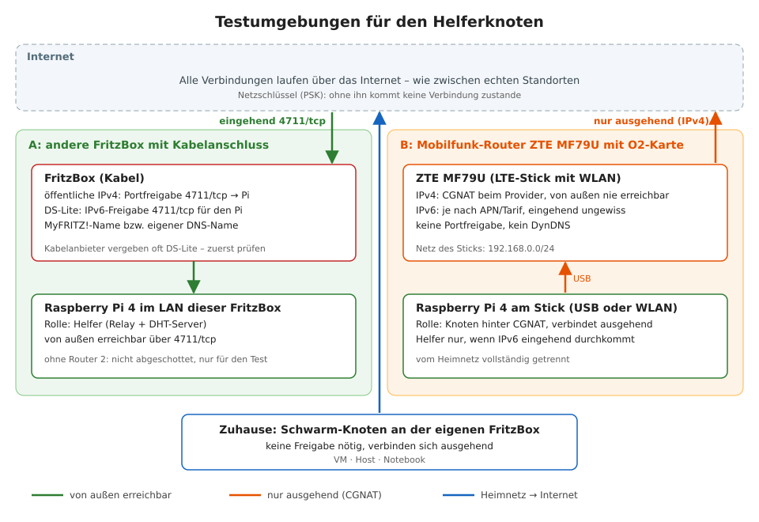

# Helferknoten auf einem Raspberry Pi

Diese Anleitung richtet einen **Helferknoten** ([spec/p2p-schicht.md](../../spec/p2p-schicht.md) § 6.1) auf einem Raspberry Pi 4 ein. Über ihn verbinden sich die Standorte eines privaten Schwarms. Der Pi rechnet nicht, nimmt keine Aufträge an und kennt keine Modelle; er ist Einstieg, DHT-Server und Relay. Alle anderen Knoten verbinden sich **ausgehend** zu ihm und brauchen keine Portfreigabe.

Es gibt einen Zielaufbau und zwei Testumgebungen, die sich schon jetzt aufbauen lassen:

| Aufbau | Rolle des Pi | von außen erreichbar | Abschnitte |
|---|---|---|---|
| **Zielaufbau:** eigene FritzBox, Router 2, Pi | Helfer, vom Heimnetz abgeschottet | IPv4 über zwei Portfreigaben | 1–4, 7–8 |
| **Test A:** andere FritzBox mit Kabelanschluss | Helfer | IPv4-Portfreigabe, bei DS-Lite IPv6-Freigabe | 1–3, 5, 7–8 |
| **Test B:** Mobilfunk-Router ZTE MF79U mit O2 | Helfer nur über IPv6, sonst Knoten hinter CGNAT | IPv4 nie, IPv6 vielleicht | 1–3, 6–8 |

**Zielaufbau:**


**Testumgebungen:**



In allen Fällen gilt:

- Von außen ist höchstens **ein Port** erreichbar: 4711/tcp.
- Wegen des Netzschlüssels (PSK) kommt ohne Schlüssel nicht einmal der Verbindungsaufbau zustande. Für Fremde ist der Port nur Rauschen.

## 1. Was du brauchst

| | |
|---|---|
| Raspberry Pi | **Pi 4** mit 2 GB RAM oder mehr (Pi 3 und 5 gehen ebenso), Netzteil USB-C 5,1 V / 3 A, Netzwerkkabel, Gehäuse mit Kühlung |
| Speicherkarte | microSD ab 16 GB, Klasse A1 oder A2, dazu ein Kartenleser am PC |
| Betriebssystem | **Raspberry Pi OS Lite (64-bit)**, derzeit auf Basis von Debian 13 „Trixie“. Die Lite-Variante hat keine Desktop-Oberfläche, die der Helfer nicht braucht. |
| Entwicklungsrechner | mit Go (zum Bauen von swarmainet) und einem SSH-Schlüssel |
| Domain | eine eigene Domain mit verwaltbarem DNS (Zielaufbau; in den Tests reicht oft ein MyFRITZ!-Name) |

Im Folgenden stehen Beispielwerte: Heimnetz `192.168.178.0/24`, Name `swarm.example.de`, Rechnername des Pi `swarm-helper`, Benutzer `admin`. Ersetze sie durch deine.

## 2. Raspberry Pi 4 vorbereiten

Den Pi richtest du am besten **zu Hause** ein, am eigenen Netz und mit Bildschirm-freiem Zugang per SSH. Danach kommt er an seinen Einsatzort.

### 2.1 SSH-Schlüssel

Falls du auf dem Entwicklungsrechner noch keinen hast:

```sh
ssh-keygen -t ed25519 -C "swarm-helper"
cat ~/.ssh/id_ed25519.pub        # diese Zeile braucht der Imager gleich
```

### 2.2 Image auf die Karte schreiben

1. **Raspberry Pi Imager ab Version 2** installieren, von [raspberrypi.com/software](https://www.raspberrypi.com/software/) (unter Linux als AppImage). **Nicht** das Paket `rpi-imager` aus Ubuntu oder Debian: Es ist Version 1.8 und zu alt für das aktuelle Raspberry Pi OS. Es schreibt das Image zwar, aber die Anpassungen aus Schritt 3 (Rechnername, Benutzer, SSH, Schlüssel) kommen nicht an.
2. Imager starten und nacheinander wählen:
   - **Gerät:** Raspberry Pi 4
   - **Betriebssystem:** *Raspberry Pi OS (other)* → **Raspberry Pi OS Lite (64-bit)**
   - **Speicher:** die microSD-Karte (alles darauf wird gelöscht)
3. **Anpassen** (der Imager fragt danach, ob die Einstellungen angewendet werden sollen):
   - Rechnername: `swarm-helper`
   - Benutzer und Kennwort: eigener Benutzer, z. B. `admin`, mit starkem Kennwort
   - Zeitzone `Europe/Berlin`, Tastatur `de`
   - **WLAN nur für Test B**, wenn der Pi per WLAN statt USB am Stick hängt (Abschnitt 6); sonst leer lassen
   - **SSH aktivieren**, „nur Authentifizierung über öffentliche Schlüssel“, und den Inhalt von `id_ed25519.pub` eintragen
4. Schreiben lassen. Der Imager prüft das Image nach dem Schreiben selbst.

### 2.3 Erster Start

1. Karte in den Pi, Netzwerkkabel an die FritzBox zu Hause, Netzteil anschließen. Der erste Start dauert ein bis zwei Minuten.
2. Anmelden:
   ```sh
   ssh admin@swarm-helper.local
   ```
   Klappt der Name nicht, steht die Adresse in der FritzBox unter *Heimnetz → Netzwerk*.
3. Aktualisieren und automatische Sicherheitsupdates einschalten:
   ```sh
   sudo apt update && sudo apt full-upgrade -y
   sudo apt install -y unattended-upgrades
   sudo reboot
   ```

### 2.4 Wenn der Pi nicht erreichbar ist

- **Nicht im Netz, nicht in der FritzBox:** auf die Leuchtdioden achten. Rot dauerhaft heißt Strom in Ordnung; grün flackert beim Start und ist danach meist aus, das ist normal. Ein gleichmäßig wiederholtes Blinkmuster der grünen LED heißt, der Pi findet kein startfähiges System: Karte neu schreiben. **Bleiben die LEDs an der Netzwerkbuchse dunkel, zuerst das Kabel tauschen**, gegen eines, das an einem anderen Gerät nachweislich funktioniert, und einen anderen Anschluss an der FritzBox nehmen. Manche Gehäuse haben einen eigenen Ein-Taster (z. B. Argon ONE); ohne Druck darauf startet der Pi nicht.
- **Im Netz, aber nicht unter `swarm-helper.local` und ohne SSH:** Dann hat der Imager die Anpassungen nicht übernommen, meist wegen einer zu alten Version (Schritt 2.2). Daran erkennbar, dass der Pi mit Monitor beim ersten Start nach Tastatur und Benutzer fragt. Nachholen am Pi mit Monitor und Tastatur:
  ```sh
  sudo hostnamectl set-hostname swarm-helper
  sudo sed -i 's/raspberrypi/swarm-helper/g' /etc/hosts
  sudo systemctl enable --now ssh
  ```
  Dann auf dem Entwicklungsrechner den Schlüssel übertragen und die Anmeldung prüfen:
  ```sh
  ssh-copy-id admin@<Adresse des Pi>
  ssh admin@<Adresse des Pi>          # muss ohne Kennwort gehen
  ```
  Erst danach auf dem Pi die Anmeldung per Kennwort abschalten:
  ```sh
  echo "PasswordAuthentication no" | sudo tee /etc/ssh/sshd_config.d/10-nur-schluessel.conf
  sudo systemctl restart ssh
  ```

## 3. swarmainet installieren

1. **Bauen** auf dem Entwicklungsrechner im Projektverzeichnis und auf den Pi kopieren:
   ```sh
   CGO_ENABLED=0 GOOS=linux GOARCH=arm64 go build -trimpath -o swarmainet-arm64 ./cmd/swarmainet
   scp swarmainet-arm64 deploy/raspberry-pi/{install.sh,config.yaml,swarmainet.service} admin@swarm-helper.local:
   ```
2. **Installieren** auf dem Pi:
   ```sh
   sudo sh install.sh
   ```
   Das Skript legt den Systembenutzer `swarmainet`, das Datenverzeichnis `/var/lib/swarmainet` (Modus 0700), die Konfiguration aus der Vorlage und den Dienst an (gehärtete systemd-Unit, startet mit dem System). Gestartet wird noch nicht. Bei späteren Aufrufen tauscht es nur das Programm aus; Konfiguration und Schlüssel bleiben.
3. **Netz beitreten:** Auf einem Knoten des Schwarms zu Hause eine Einladung erzeugen:
   ```sh
   swarmainet invite -with-key
   ```
   und auf dem Pi damit beitreten:
   ```sh
   sudo -u swarmainet swarmainet join -config /var/lib/swarmainet/config.yaml '<link>'
   ```
   `join` trägt Netz-Kennung und Schlüssel ein. Der Link enthält den Netzschlüssel: nur vertraulich übertragen, etwa per SSH, und danach nicht aufheben.
4. **Öffentlichen Namen eintragen:**
   ```sh
   sudoedit /var/lib/swarmainet/config.yaml
   ```
   Unter `announce` den Namen, unter dem der Pi am Einsatzort erreichbar ist (Abschnitt 4, 5 oder 6), z. B. `/dns/swarm.example.de/tcp/4711`. Solange der Pi zu Hause zum Ausprobieren läuft oder der Name noch nicht auf den Einsatzort zeigt, bleibt `announce: []` leer. Für den Helfer am besten eine eigene Subdomain nehmen (z. B. `helper.<deine-domain>`), damit die Hauptdomain etwa für eine Webseite frei bleibt. Ohne `announce` kennt der Pi nur seine lokale Adresse, und mit der kann außerhalb niemand etwas anfangen. `/dns/` löst A- und AAAA-Einträge auf, also IPv4 und IPv6.
5. **Neu starten und Peer-ID notieren.** Der Dienst startet nach jedem Hochfahren von selbst, läuft also womöglich schon mit der alten Konfiguration; Änderungen liest er erst beim Neustart. Deshalb immer `restart`, nicht `start`:
   ```sh
   sudo systemctl restart swarmainet
   journalctl -u swarmainet -f                     # Protokoll, Strg+C beendet
   sudo -u swarmainet swarmainet status -config /var/lib/swarmainet/config.yaml | grep -m1 peer_id
   ```
6. Pi herunterfahren (`sudo poweroff`) und an den Einsatzort bringen.

**Aktualisieren:** neues `swarmainet-arm64` kopieren und `sudo sh install.sh` erneut aufrufen; der Dienst wird dabei neu gestartet.

**Alternative mit Docker:** Der Helfer läuft auch im Container ([deploy/docker](../docker/compose.yaml)), das Image baut auf dem Pi für arm64. Nativ mit systemd braucht weniger Speicher und ist auf dem Pi die einfachere Wahl.

## 4. Zielaufbau: FritzBox, Router 2 und DNS

Hier hängt der Pi hinter einem zweiten Router, der ihn vom Heimnetz abschottet. Beispielwerte: Router 2 mit WAN `192.168.178.2` und LAN `192.168.50.0/24`, Pi `192.168.50.10`.

### 4.1 DNS-Eintrag statt Domain-Weiterleitung

Die „Domain-Weiterleitung“ vieler Anbieter ist eine **HTTP-Umleitung**: Ein Webserver des Anbieters schickt Browser zu einer anderen Adresse weiter. Für libp2p ist das unbrauchbar, denn der Knoten spricht kein HTTP. Gebraucht wird ein **DNS-Eintrag**, der `swarm.example.de` auf die aktuelle IPv4-Adresse der FritzBox zeigen lässt:

- **A-Eintrag per DynDNS**, wenn der Anbieter eine Update-URL anbietet. In der FritzBox unter *Internet → Freigaben → DynDNS* „DynDNS benutzen“ aktivieren, „Benutzerdefiniert“ wählen und Update-URL, Domainname, Benutzer und Kennwort des Anbieters eintragen.
- **CNAME auf MyFRITZ!**: in der FritzBox ein MyFRITZ!-Konto einrichten (*Internet → MyFRITZ!-Konto*). Die FritzBox bekommt einen Namen wie `xxxxxxxx.myfritz.net`, der ihr automatisch folgt. Beim Domain-Anbieter `swarm.example.de` als CNAME darauf zeigen lassen.

Die TTL des Eintrags sollte kurz sein, z. B. 300 s. **Einen Portfilter gibt es im DNS nicht**: DNS bildet nur Namen auf Adressen ab und sieht weder Ports noch Verkehr. Gefiltert wird in FritzBox und Router 2.

Manche Anbieter nennen das „DNS-Weiterleitung“. Ob sie passt, zeigt sich am Ergebnis:

```sh
dig +short swarm.example.de     # muss die öffentliche IPv4 der FritzBox liefern
```

- Erscheint die IPv4 der FritzBox (*Internet → Online-Monitor*), allein oder unter einem MyFRITZ!-Namen, ist alles richtig.
- Erscheint eine IP des Domain-Anbieters, ist es eine HTTP-Umleitung; Port 4711 kommt dann nie bei der FritzBox an.
- Der Eintrag muss der **wechselnden** IP folgen. Zum Testen *Internet → Online-Monitor → Neu verbinden* und `dig` nach einigen Minuten wiederholen.

### 4.2 FritzBox

1. **Öffentliche IPv4 prüfen:** *Internet → Online-Monitor*. Steht dort „DS-Lite“ oder keine eigene IPv4-Adresse, kommt eine IPv4-Freigabe nie an; siehe Abschnitt 9.
2. **Router 2 eine feste Adresse geben:** *Heimnetz → Netzwerk → Netzwerkverbindungen*, Router 2 bearbeiten, „Diesem Netzwerkgerät immer die gleiche IPv4-Adresse zuweisen“, z. B. `192.168.178.2`.
3. **Portfreigabe nur an Router 2:** *Internet → Freigaben → Portfreigaben → Gerät für Freigaben hinzufügen*, Router 2 wählen, dann *Neue Freigabe → Portfreigabe*: „Andere Anwendung“, Bezeichnung `swarmainet`, Protokoll **TCP**, Port an Gerät **4711** bis 4711, Port extern **4711**, „Freigabe aktivieren für IPv4“.
4. **Nicht** „Selbstständige Portfreigaben erlauben“ und **nicht** „Exposed Host“ für Router 2 aktivieren.

### 4.3 Router 2

Die Menüs heißen bei jedem Hersteller anders. Einzustellen ist:

1. **WAN** am LAN-Anschluss der FritzBox, Adresse `192.168.178.2`.
2. **LAN** als eigenes Netz, z. B. `192.168.50.1/24`; dem Pi per DHCP-Reservierung immer `192.168.50.10` geben.
3. **Portweiterleitung** WAN 4711/tcp → `192.168.50.10:4711`.
4. **Firewall, und das ist der wichtigste Punkt:** Ohne Regel erreicht der Pi das Heimnetz, denn Router 2 schickt alles an die FritzBox weiter. Deshalb **neue Verbindungen aus dem LAN von Router 2** an alle privaten Netze sperren, außer an das eigene:
   - Ziel `192.168.178.0/24` (Heimnetz): sperren
   - Ziel `10.0.0.0/8`, `172.16.0.0/12` und `192.168.0.0/16` außer `192.168.50.0/24`: sperren
   - alles andere (Internet): erlauben

   **Antworten müssen durchkommen:** Verbindet sich ein Knoten aus dem Heimnetz mit dem Pi, gehen dessen Antworten an eine Adresse im Heimnetz. Die Regel darf deshalb nur **neue** Verbindungen sperren; bestehende und zugehörige (*established*/*related*) müssen erlaubt bleiben. Bei OpenWrt ist das eine Regel in der *forward*-Kette mit dem Zustand `NEW`.
5. **UPnP**, **Fernwartung** und **WPS** abschalten, eigenes Admin-Kennwort setzen.

Prüfen vom Pi aus:

```sh
ping -c1 1.1.1.1            # Internet: muss gehen
ping -c1 192.168.178.29     # ein Gerät im Heimnetz: muss scheitern
```

`announce` in der Pi-Konfiguration: `/dns/swarm.example.de/tcp/4711`.

## 5. Testumgebung A: andere FritzBox mit Kabelanschluss

Der Pi hängt direkt im LAN einer anderen FritzBox, ohne Router 2. Das ist ein echter Test über das Internet: Die Knoten zu Hause erreichen den Pi über den Provider, nicht über die eigene FritzBox.

> **Nur für den Test:** Ohne Router 2 ist der Pi nicht vom LAN dieser FritzBox abgeschottet. Wer den Pi übernimmt, erreicht die Geräte dort. Den Betreiber der FritzBox vorher fragen und den Pi nach dem Test wieder abbauen.

1. **Anschlussart prüfen:** *Internet → Online-Monitor*. Kabelanbieter vergeben häufig **DS-Lite**, dann gibt es keine eigene IPv4, aber öffentliches IPv6.
2. **Pi anschließen** (Kabel an die FritzBox) und unter *Heimnetz → Netzwerk* „Diesem Netzwerkgerät immer die gleiche IPv4-Adresse zuweisen“ setzen.
3. **Freigabe für den Pi:** *Internet → Freigaben → Portfreigaben → Gerät für Freigaben hinzufügen* → `swarm-helper` → *Neue Freigabe → Portfreigabe*, TCP, Port 4711 auf 4711:
   - **Mit öffentlicher IPv4:** „Freigabe aktivieren für IPv4“ und für IPv6
   - **Bei DS-Lite:** nur „Freigabe aktivieren für IPv6“; IPv4 kommt dort nie an
4. **Name:** Mit einem MyFRITZ!-Konto auf dieser FritzBox (*Internet → MyFRITZ!-Konto*) bekommen Geräte mit Freigaben in der Regel einen eigenen Namen der Form `swarm-helper.xxxxxxxx.myfritz.net`, der bei IPv6 auf das Gerät selbst zeigt; er erscheint bei den Freigaben bzw. im MyFRITZ!-Konto. Der Name der FritzBox selbst (`xxxxxxxx.myfritz.net`) genügt, wenn nur IPv4 freigegeben ist. Alternativ zeigt ein CNAME der eigenen Domain auf einen dieser Namen.
5. **`announce`** in der Pi-Konfiguration auf diesen Namen setzen, z. B. `/dns/swarm-helper.xxxxxxxx.myfritz.net/tcp/4711`, dann `sudo systemctl restart swarmainet`.
6. **Prüfen:** `dig +short A …` und `dig +short AAAA …` für den Namen. Bei DS-Lite genügt der AAAA-Eintrag; die Knoten zu Hause brauchen dann IPv6, das die eigene FritzBox in der Regel hat.

## 6. Testumgebung B: Mobilfunk-Router ZTE MF79U mit O2

Der ZTE MF79U ist ein LTE-Stick mit eigenem WLAN. Mobilfunkanbieter, auch O2, geben IPv4 nur über **CGNAT** heraus: Der Pi ist per IPv4 von außen **nie** erreichbar, und eine Portfreigabe im Stick nützt nichts. Über IPv6 kann es klappen, das hängt aber von Tarif, APN und der Firewall des Sticks ab. Daraus ergeben sich zwei Varianten:

- **B1, Pi als Helfer über IPv6:** nur, wenn die Prüfung unten zeigt, dass IPv6 von außen ankommt.
- **B2, Knoten hinter CGNAT:** Am Stick hängt ein gewöhnlicher Knoten, etwa das **Notebook** des Schwarms per WLAN. Er verbindet sich ausgehend zum Helfer aus Test A und testet so Relay und Hole Punching hinter CGNAT. Das ist der wahrscheinlichere und ebenso wertvolle Test.

### 6.1 Stick einrichten

1. Weboberfläche des Sticks: `http://192.168.0.1`, Kennwort steht auf dem Aufkleber (bei Werkseinstellung oft `admin`). Ein eigenes Kennwort setzen.
2. **APN** in den Netzwerkeinstellungen: bei O2-Verträgen meist `internet`, bei Prepaid `pinternet.interkom.de`. Als **PDP-Typ IPv4v6** wählen, sonst gibt es kein IPv6. Die genauen Menünamen hängen von der Firmware ab.
3. Nach dem Verbinden zeigt die Statusseite, ob eine IPv6-Adresse zugeteilt wurde.

### 6.2 Pi am Stick

- **Per USB (empfohlen):** Stick in einen USB-Port des Pi. Er erscheint als Netzwerkschnittstelle (`usb0` oder `eth1`) und vergibt per DHCP eine Adresse aus `192.168.0.0/24`; der Pi 4 versorgt ihn mit Strom. Erscheint nach `ip -br link` keine neue Schnittstelle, meldet sich der Stick noch als Speicher: `sudo apt install -y usb-modeswitch` und neu stecken. Ein angeschlossenes Netzwerkkabel vorher abziehen, damit der Pi den Stick als Weg ins Internet nimmt.
- **Per WLAN:** das WLAN des Sticks beim Anpassen im Imager eintragen (Abschnitt 2.2) oder später mit `sudo nmcli device wifi connect <SSID> password <Kennwort>`.

Ob IPv4 und IPv6 nach draußen funktionieren:

```sh
ip -br addr                    # Adresse aus 192.168.0.x, ggf. öffentliche IPv6 (2a0…)
ping -c1 1.1.1.1 && ping -6 -c1 2606:4700:4700::1111
```

### 6.3 Variante B1: Pi als Helfer über IPv6

1. **Erreichbar?** Die öffentliche IPv6 des Pi steht in `ip -br addr`. Von einem Knoten zu Hause:
   ```sh
   swarmainet ping /ip6/<IPv6 des Pi>/tcp/4711/p2p/<Peer-ID des Pi>
   ```
   Meldet er „Erreichbar (direkt)“, kommt IPv6 von außen an. Im privaten Netz prüft der Knoten das nicht selbst (die Angabe `reachability_by_family` im Status gibt es nur im offenen Netz); dieser `ping` entscheidet.
2. **Name:** Der Stick kann kein DynDNS. Der Pi meldet seine IPv6 deshalb selbst beim Domain-Anbieter, mit dessen Update-URL, z. B. alle 5 Minuten per systemd-Timer oder cron:
   ```sh
   IP6=$(ip -6 -o addr show scope global | grep -v temporary | awk '{print $4}' | cut -d/ -f1 | head -1)
   curl -fsS "https://<update-url-des-anbieters>?hostname=swarm.example.de&myipv6=$IP6"
   ```
   Gemeldet wird die dauerhafte Adresse, nicht eine der temporären, die das System regelmäßig wechselt. Der genaue Aufbau der URL steht beim Anbieter. `announce` dann auf `/dns/swarm.example.de/tcp/4711`.
3. Die Knoten zu Hause erreichen den Pi so nur über IPv6.

Kommt IPv6 nicht durch, bleibt Variante B2.

### 6.4 Variante B2: Knoten hinter CGNAT

1. Pi als Helfer in Testumgebung A betreiben.
2. Das Notebook (oder einen anderen Knoten des Schwarms) mit dem WLAN des Sticks verbinden.
3. Prüfen, wie es den Helfer und die Knoten zu Hause erreicht:
   ```sh
   swarmainet ping <Peer-ID des Pi>
   swarmainet status          # peers: via relay, nach Hole Punching direct
   ```

### 6.5 Datenvolumen

Ein Helfer überträgt in Ruhe wenig: Verbindungserhalt, DHT und Statusabfragen, grob einige zehn MB am Tag. Über das Relay laufende Aufträge kommen hinzu, je Verbindung höchstens 8 MiB. Das Datenvolumen der O2-Karte im Blick behalten.

## 7. Knoten verbinden

Alle Knoten, zu Hause und an anderen Standorten, erreichen den Pi über **seinen öffentlichen Namen**. So nehmen alle denselben Weg, und genau der soll sich bewähren.

**Knoten mit Schlüssel** (die zu Hause) tragen nur die Adresse ein:

```yaml
node:
  static_peers:
    - /dns/swarm.example.de/tcp/4711/p2p/<Peer-ID des Pi>
```

**Neue Knoten** treten per Einladung bei, erzeugt auf dem Pi:

```sh
sudo -u swarmainet swarmainet invite -config /var/lib/swarmainet/config.yaml -with-key
```

und auf dem neuen Knoten `swarmainet join '<link>'`. Der Link enthält dank `announce` den öffentlichen Namen und den Netzschlüssel; er muss **vertraulich** weitergegeben werden.

**Zielaufbau, aus dem Heimnetz (NAT-Loopback):** Ein Knoten zu Hause löst `swarm.example.de` zur öffentlichen IP der eigenen FritzBox auf, und die FritzBox muss die Verbindung an die eigene Portfreigabe zurückleiten. Dabei geht der Verkehr nicht wirklich ins Internet. Klappt das Zurückleiten nicht, ist der Ausweichweg die WAN-Adresse von Router 2, `/ip4/192.168.178.2/tcp/4711/p2p/<Peer-ID des Pi>`. In den Testumgebungen stellt sich die Frage nicht, denn dort liegt der Pi an einem anderen Anschluss.

Danach reservieren alle Knoten beim Pi einen Relay-Platz und finden die anderen Standorte über den Peer-Austausch. Verbindungen zwischen den Standorten laufen über den Pi oder, wenn Hole Punching gelingt, direkt.

## 8. Prüfen

- **Port von außen offen?** Von einem Gerät außerhalb, etwa dem Notebook am Handy-Hotspot: `nc -vz swarm.example.de 4711` (bei IPv6 `nc -6 -vz …`). Die Verbindung muss zustande kommen; ohne Netzschlüssel bricht danach der Handshake ab, und das ist richtig so.
- **Von zu Hause:** `swarmainet ping /dns/swarm.example.de/tcp/4711/p2p/<Peer-ID des Pi>` meldet „Erreichbar (direkt)“.
- **An anderen Standorten:** `swarmainet ping <Peer-ID des Pi>` meldet „Erreichbar (direkt)“; `swarmainet status` zeigt unter `networks[].relay_reservations` den Pi und für die Knoten zu Hause `via: relay` oder nach Hole Punching `direct`.
- **Auf dem Pi:** `swarmainet status` listet die Peers aller Standorte; `hints` sollte leer sein.
- **Zielaufbau, Abschottung:** die beiden `ping`-Befehle aus Abschnitt 4.3.

## 9. Wenn keine öffentliche IPv4 da ist (DS-Lite, CGNAT)

Normale Knoten stört das nicht: Sie verbinden sich ausgehend und werden über Relay oder IPv6 erreicht (siehe [Netzarten](../../docs/netze.md#ipv6-und-ds-lite)). Für den Helfer, der von außen erreichbar sein muss, gibt es diese Wege:

- **IPv6-Freigabe**, wenn der Pi direkt an der FritzBox hängt (Test A) oder eine öffentliche IPv6 hat (Test B1).
- **IPv6 im Zielaufbau:** Damit ein Gerät hinter Router 2 eine öffentliche IPv6 bekommt, muss Router 2 ein Präfix von der FritzBox beziehen (Prefix Delegation, *Heimnetz → Netzwerk → Netzwerkeinstellungen → IPv6-Einstellungen*) und das selbst unterstützen. Dann IPv6-Freigabe für 4711/tcp und AAAA-Eintrag. Das ist deutlich aufwendiger als IPv4.
- **Brückenknoten** statt Portfreigabe, der beide Standorte ausgehend erreicht ([Netzarten](../../docs/netze.md#mehrere-standorte)).
- **Helfer auf einem Server** mit öffentlicher Adresse ([deploy/docker](../docker/compose.yaml)).

## 10. Sicherheit

- **Was von außen sichtbar ist:** nur 4711/tcp. Ohne Netzschlüssel kommt keine libp2p-Verbindung zustande. Der Pi nimmt keine Aufträge an, und das Gateway (`127.0.0.1:7711`) lauscht nur lokal.
- **Der Pi kennt den Netzschlüssel.** Wer ihn übernimmt, ist Mitglied des Schwarms. Deshalb SSH nur mit Schlüssel, automatische Updates, und gerät er in falsche Hände: neuer Netzschlüssel für alle (`swarmainet psk`, neue Einladungen).
- **Abschottung:** Im Zielaufbau hängt sie an der Firewall-Regel von Router 2; nach jeder Änderung dort mit `ping` prüfen. In Test A gibt es keine Abschottung. In Test B ist der Pi vom Heimnetz ohnehin vollständig getrennt.

## 11. Kann der Pi später abgeschaltet werden?

Der Helfer ist eine **Rolle**, kein bestimmtes Gerät: ein Mitglied, das von allen Standorten aus erreichbar ist und `relay_service: true` hat.

**Privater Schwarm über mehrere Standorte:** Ist der Pi das einzige erreichbare Mitglied, gilt nach dem Abschalten:

- Innerhalb eines Standorts läuft alles weiter (LAN, mDNS).
- Direkte Verbindungen zwischen den Standorten, die per Hole Punching entstanden sind, bleiben bestehen, bis sie abreißen.
- Verbindungen über den Pi als Relay brechen ab, spätestens nach der Grenze von 10 Minuten.
- **Neue Verbindungen zwischen den Standorten kommen nicht mehr zustande.** Die Adressen im Peer-Cache zeigen auf Geräte hinter NAT, und auch Hole Punching braucht zum Verabreden ein Relay.

Der Pi wird überflüssig, sobald ein anderes Mitglied erreichbar ist und `relay_service: true` hat, etwa ein Knoten mit öffentlichem IPv6 und Firewall-Freigabe oder ein Server. Zwei solche Mitglieder an verschiedenen Orten sichern zugleich gegen den Ausfall eines einzelnen ab.

**Offenes Netz:** Hier ist der Helfer nur Starthilfe, wie die Bootstrap-Knoten bei BitTorrent. Sobald genug andere Knoten öffentlich erreichbar sind und Relay anbieten, tragen Peer-Cache, Peer-Austausch und DHT das Netz; neue Knoten steigen über eine Einladung eines beliebigen Mitglieds oder einen Tracker ein. Dafür braucht es Freiwillige mit `relay_service`; die Portfreigabe per UPnP (`port_mapping`) erhöht die Zahl erreichbarer Knoten.

## 12. Später: offenes Netz und Tracker

- **Offenes Netz zusätzlich:** einen zweiten Port freigeben und weiterleiten (z. B. 4712, TCP und UDP) und in der Pi-Konfiguration ein weiteres Netz eintragen:
  ```yaml
  node:
    networks:
      - network_id: swarmainet
        listen: [/ip4/0.0.0.0/tcp/4712, /ip4/0.0.0.0/udp/4712/quic-v1, /ip6/::/tcp/4712, /ip6/::/udp/4712/quic-v1]
        announce: [/dns/swarm.example.de/tcp/4712, /dns/swarm.example.de/udp/4712/quic-v1]
  ```
  Das offene Netz bekommt automatisch eine eigene Peer-ID.
- **Tracker:** `swarmainet tracker` braucht HTTPS, also einen Reverse-Proxy mit Zertifikat (z. B. Caddy) und die Ports 443/tcp und meist 80/tcp. Für einen Schwarm mit einem festen Helfer ist er nicht nötig, weil Einladung und Peer-Austausch genügen.
