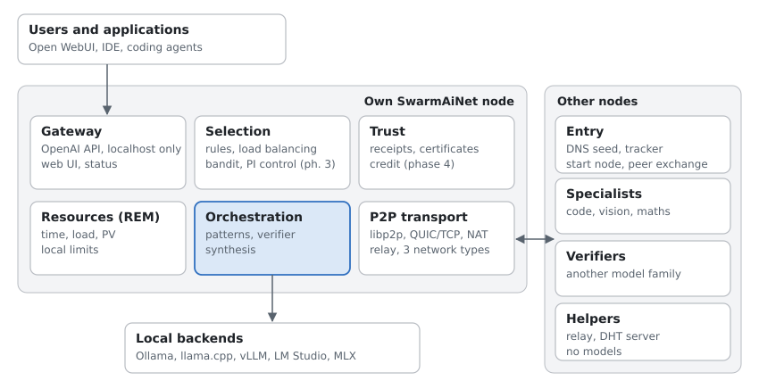
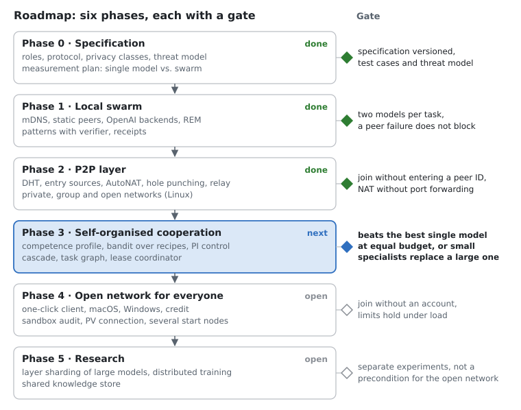

# SwarmAiNet: overall concept

**English** · [Deutsch](de/concept.md)

**Version 2 of 18 Nov 2026, last changed on 21 Nov 2026.** The project and domain are called **Ai-Swarms.net**, the software **SwarmAiNet** (program `swarmainet`). The first version of 14 Oct 2026 still carried the working title "KI-Schwarm" and is kept in the [archive](archive/concept-2026-10-14-de.pdf) (in German). It merged a Claude concept and a GPT-5 concept and decided the points on which they contradicted each other. This version brings the concept up to date with the specification and the implementation; what has changed compared with the first version is listed at the end ([changes](#changes-from-version-1)). The [specification](../spec/README.md) is authoritative in the details.

SwarmAiNet is a self-governing P2P network in which different local AI models form a team per task, check each other and thus aim to deliver better results than the best single model. It first connects your own devices, then groups and companies and finally any participants with restricted rights. The added value over the best single model is not assumed but measured.

## Decisions

| Question | Decision | Reason |
|---|---|---|
| Participation | **Private by default:** `init` creates a network of your own; the open network only via `init -open` or an invitation | Own devices first; nobody becomes visible to strangers without wanting to |
| Network types | **Three network types:** private network (PSK), group network (certificate per node), open network; a node can belong to several | Own devices, groups and strangers need different levels of trust; priority in this order |
| Automatic port forwarding (UPnP/NAT-PMP/PCP) | **Opt-in**, off by default | Changes router settings; IPv6, hole punching and relay cover the normal case without forwarding |
| Offering a relay to others | in the open network **automatic** as soon as the node is publicly reachable, with conservative limits and can be disabled; in private and group networks via own helpers | Without relays at reachable nodes, the open network falls apart into islands as soon as the start node goes away; content stays end-to-end encrypted |
| Accepting foreign tasks | **Opt-in** (`accept_public_tasks: false` by default) | Liability and GDPR: the user consciously decides whether and which foreign prompts are processed |
| Tools for foreign models | **List per network** (`allowed_tools`); none without a list in the open network and in group networks | Tools are executed by the requester's application; a model that sees them can trigger their invocation |
| Membership in groups | **Certificates without a certificate authority**: root key offline, issuers, roles `member` and `helper`, individual revocation | Admit and remove members individually; a helper carries the network without seeing tasks |
| Entry into the open network | **DNS seed** `seed.ai-swarms.net`, start node, tracker, invitation; then peer exchange and DHT | Entry nodes can be exchanged without shipping new software |
| PV control | **Start/stop via thresholds with hysteresis**; PI controller only with several slots or an available power limit | With one slot a PI controller is oversized; thresholds are easier to understand and test |
| Implementation language | **Go with go-libp2p**; the protocol stays language-independent | go-libp2p is the reference implementation; a second implementation (e.g. Rust) follows for interoperability tests |
| GPU limit | **Parallel jobs, GPU minutes, mean utilisation over a time window, additional power, temperature** instead of an instantaneous percentage | Individual kernels briefly reach 100 %; an instantaneous limit cannot be kept |
| Searching for capabilities | **Own index scheme** on top of the DHT: references per capability spread over several keys | A standard DHT does not filter by combined capabilities; popular tags would otherwise overload individual nodes |
| Coordinating a task | **The requesting peer coordinates**; handover via lease on failure from phase 3 | No centre, but also no loss of running tasks |
| Incentives | **No mandatory currency**; signed receipts since phase 1, mutual credit from phase 4 | Measure first, then settle; the data for the credit is then already available |

**Default at first start:** `swarmainet init` sets up a private network of your own with a fresh key (decided on 21 Nov 2026). The open network is a deliberate choice (`init -open` or an invitation into the open network), as in version 1; this way nobody becomes visible to strangers without wanting to.

## Vision and guiding principles

Not as many tokens as possible from one model, but the best combination of suitable, different models. A code model, a maths model, a vision model and a small classifier on different home computers complement each other; models of different families make different mistakes and can check each other.

Taken over from BitTorrent are independent peers, distributed search, voluntary resource sharing and resilience. Not taken over is the assumption that tasks are interchangeable chunks: an answer needs suitable competence, context and review.

| Principle | Consequence |
|---|---|
| From own to open | First your own devices, then groups, then everyone; each network type with its own trust and its own rights |
| Model-agnostic | No commitment to a model family, quantisation, modality or backend |
| Self-organised | Discovery, selection, reputation and settlement run distributed; global behaviour emerges from local rules |
| No centre | No accounts, no central model lists, no payment service, no permanent coordinator; start nodes and trackers are only a jump start |
| Sovereign nodes | Every node decides for itself whom it trusts, what it accepts and how much hardware it gives |
| Minimal data access | A peer only receives the context its subtask needs |
| Traceable | Results carry origin, evidence, uncertainty and participating roles |
| Open standards | Versioned specification, at least two implementations, fork as a last resort |

**Not promised:** secrecy on foreign computers, correctness of majority answers, complete Sybil resistance, unlimited real-time scaling.

## Network types

| | Private network | Group network | Open network |
|---|---|---|---|
| For | your own devices | groups, clubs, companies | everyone |
| Access | shared key (PSK) | certificate per node | free |
| Remove individuals | no, only a new key for everyone | yes, via revocation list within seconds | – |
| Trust | all members | admitted members, not helpers | nobody except `trusted_peers` |
| Across sites | own helper | own helper that cannot read along | foreign relays and DHT |

Details: [network types](networks.md), [P2P layer](../spec/p2p-layer.md), [membership networks](../spec/membership.md).

## Architecture



The node does not compute itself: it accepts requests via the gateway, chooses pattern and effort, distributes subtasks to other nodes via libp2p and uses the local backends for its own inference. The resource manager (REM) limits how much foreign work its own hardware takes on. DHT, peer exchange, start nodes and helpers only provide contacts and references, no control and no trust. Selection follows fixed rules today; bandit and controllers come in phase 3. Packages and modules: [architecture](architecture.md).

## Capabilities and competence measurement

The swarm does not ask "Who has model X?" but "Who can do task Y under conditions Z?", and it only believes self-declarations once measurements confirm them.

**Capability announcement:** signed, with an expiry time (TTL 5 min), fetched directly from the peer. It names capabilities, modalities, context length, tool ability, free slots and policy, but no prompts, no internal IPs and no hardware or energy data. It is carried in the protocol's signed envelope ([protocol](../spec/protocol-v0.1.md) § 3, § 4.1):

```json
{
  "peer_id": "<peer-id>",
  "expires_at": "2026-10-14T12:05:00Z",
  "agents": [{ "agent_id": "ollama/qwen2.5-coder:7b", "model_family": "qwen",
               "skills": ["code.python", "code.review"], "modalities": ["text"],
               "context_max": 32768, "strength": 5, "tools": true }],
  "availability": { "slots_now": 1, "windows": [] },
  "policy": { "accepts": ["trusted"], "retention": "no-prompt-storage" }
}
```

**Capability taxonomy:** a shared basic vocabulary (`reasoning.math`, `code.<language>`, `code.review`, `vision.ocr`, `retrieval.embed`, `domain.engineering` …) plus free tags for new things. The DHT only contains references "peer X offers capability Y", spread over four keys per capability, so that no node becomes a bottleneck ([P2P layer](../spec/p2p-layer.md) § 5).

**Measured profile** (phase 3; recorded since 21 Nov 2026, not yet used for selection): every node keeps a competence value per capability according to Glicko-2 for the agents it works with. Sources, by weight:

1. Objectively checkable tasks: code with tests, maths with an exact solution, extraction with ground truth.
2. Canary tasks with a known solution.
3. Verdicts of verifiers of other families; verifiers get a rating of their own for their hit and false alarm rate.
4. User feedback on the final result.

The self-declared `strength` only serves as a starting value. Reputation is context-dependent: good C++ results do not prove medical competence. Details: [cooperation](../spec/cooperation.md) § 2.

## Roles and cooperation patterns

Roles are dynamic: the same node can be a specialist for one task and a verifier for the next. Basic rule: creator and verifier come from different model families.

| Role | Task | Typically suitable |
|---|---|---|
| Router | Classify the request: answer directly or process in the swarm | today a keyword heuristic; later a small, fast model, local |
| Planner | Split the task into subtasks, create a task graph | large reasoning model, preferably local |
| Specialist | Solve a subtask in its domain | domain model |
| Verifier | Check a result, run tests, name errors | model of another family, tool node |
| Synthesiser | Merge verified partial results, name open risks | strong generalist, preferably local |
| Tool node | Embeddings, reranking, OCR, running code in a sandbox | special models, also weak hardware |
| Network helper | Entry, DHT server, relay; later storing the benchmark pool | reachable nodes without a GPU, e.g. a VPS |

| Pattern | Flow | Use | Status |
|---|---|---|---|
| Expert routing (`single`) | Request to the best specialist, the next one on failure | short, clearly assignable questions; tasks with tools | implemented |
| Draft + verifier + synthesis (`draft_verify_synthesize`) | Create, review independently, revise only if flaws are found | code, analyses; today's default | implemented |
| Parallel diversity (`parallel`, `parallel_verify`) | Several models solve independently, synthesis, optionally reviewed | fact questions, difficult problems | implemented |
| Cascade | Cheap model first, escalate when uncertain | future default for most requests | phase 3 |
| Decompose & distribute | Task graph, subtasks in parallel | multi-part tasks, mixed modalities | phase 3 |
| Mixture-of-agents | Improve answers layer by layer | maximum quality, time not critical | idea |
| Debate | Opposing positions, verdict by a third party | trade-offs, decisions | idea |
| Human in the loop | A human approves critical steps | file changes, external actions | today via the application (tool approval) |

Voting does not create truth: verifiable evidence counts more than agreement, and verifiers give their verdict before they see other verdicts.

## Task protocol

Every task has a coordinator, hard limits and a traceable result path. The prompt is never spread publicly, but only sent encrypted to selected providers. Details: [protocol v0.1](../spec/protocol-v0.1.md).

**Coordination:** the requesting peer coordinates its task. From phase 3 it holds a lease with an expiry time for this; if it is no longer reachable, a named substitute coordinator takes over, provided privacy class and delegation policy allow it. Planner and synthesiser preferably run locally, because only they see the whole picture.

**Limits per task:** task ID, deadline, maximum delegation depth, maximum number of subtasks, token budget, maximum transfer volume, privacy class. Delegations inherit equal or stricter rights and consume the same overall budget.

**States:** `CREATED → DISCOVERING → OFFERED → ACCEPTED → RUNNING → REVIEWING → COMPLETED`, plus the terminal states `REJECTED`, `CANCELLED`, `EXPIRED`, `FAILED`. Repetitions are idempotent, so that nothing is executed or settled twice.

| Message | Purpose | Status |
|---|---|---|
| `CAPABILITY_ANNOUNCE` | Signed, expiring capability announcement | implemented |
| `TASK_PROPOSE` | Offer of a subtask with budget and privacy class | implemented |
| `TASK_ACCEPT` | Acceptance with a short-lived, limited lease | implemented |
| `TASK_REJECT` | Refusal as a terminal state of its own (added compared with version 1) | implemented |
| `TASK_PROGRESS` | Status or token stream | implemented |
| `TASK_RESULT` | Result with origin and evidence | implemented |
| `TASK_CANCEL` | Abort and clean up, also when the provider needs its hardware itself | implemented |
| `TASK_RECEIPT` | Receipt signed by both sides | implemented |
| `TASK_BID` | Conditions, free capacity, expected runtime | phase 3 |
| `VERIFY_REQUEST` | Targeted independent review | phase 3 |
| `TRUST_ATTESTATION` | Optional, selectively shared proof of experience | deferred |

Every message carries protocol version, task ID, sender, expiry time, nonce and signature; unknown optional fields do not lead to an abort. The protocols are named `/swarmainet/<name>/<version>`, e.g. `/swarmainet/task/0.1`.

**Result object:** separates answer, evidence, limitations and confidence. Self-reported confidence is not a calibrated probability; a hash proves that an artefact is unchanged, not that it is correct. For tasks with tools it additionally contains the model's tool calls.

```json
{
  "task_id": "<id>",
  "producer_peer": "<peer-id>",
  "role": "verifier",
  "result": { "status": "partial", "summary": "Two tests fail" },
  "evidence": [{ "type": "test-report", "digest": "sha256:<digest>" }],
  "confidence": { "value": 0.6, "kind": "self-reported" },
  "limitations": ["Only tested on Linux"]
}
```

## Selection and control

Today the orchestrator selects by rules: skill, on a tie load balancing, verifier by family and model strength. From phase 3, a bandit decides which model combination works, and PI controllers decide how much effort is used. Selection is a discrete decision and therefore not a task for a PID controller. Details: [cooperation](../spec/cooperation.md).

**Selection (bandit over recipes):** not all model combinations are rated, but recipes made of pattern and role casting, e.g. "coder family A + verifier of another family". Hard filters apply first: modality, privacy class, availability, licence, allowed tools. Among the rest, Thompson sampling per task category chooses the cheapest recipe that is expected to reach the quality target. A small share goes to new agents (exploration); diversity of model families is deliberately preferred for reviews.

**Control loops in the node:**

| Control loop | Actual value | Target | Manipulated variable |
|---|---|---|---|
| Quality (outer) | filtered success rate: tests, verifier verdict, feedback | task-dependent, e.g. 90 % | effort budget: number of models, review rounds |
| Cascade | error rate of the cheap stage | e.g. ≤ 5 % | confidence threshold for escalation |
| Latency | p90 response time | e.g. 20 s | parallelism, fallback timeout |
| Own load | swarm load on your own hardware | strictest limit of the resource policy | accepted jobs, slots |

**Control rules:**

- PI instead of PID: the quality measurement is noisy and comes with dead time; a D component would mainly amplify noise.
- Smooth the measured variable with an EWMA, dead band against constant readjustment.
- Anti-windup: at the limit, integration stops, even if peers report "not available".
- Separate controllers per task category, otherwise the controller only controls the task mix.
- The manipulated variable is mapped to whole numbers, with hysteresis and cool-down.
- The quality controller can never overrule the local resource policy of other nodes.
- Against oscillations in the network: small gains, random jitter, AIMD as in TCP congestion control.

```math
u_k = u_0 + K_p e_k + K_i \sum_{j \le k} e_j \Delta t, \qquad e_k = q^{*} - \bar{q}_k
```

## Trust, incentives and Sybil protection

There is no global reputation value and no currency: every node forms its own judgement and keeps its own accounts.

**Trust per network type:** in the private network all members are trusted; in the group network the admitted members with role `member` or `issuer`, not the helpers; in the open network only explicitly entered `trusted_peers`. Group networks need no certificate authority: the network ID is derived from the root key, issuers issue certificates, and revocation lists spread within seconds ([membership networks](../spec/membership.md)).

**Subjective, transitive trust** (open network, from phase 3): everyone computes trust from their own experience and the ratings of peers they trust. The starting point is one's own experience and optionally self-chosen acquaintances or communities, not globally predefined trust anchors. Rings that rate each other highly thus have no influence as long as nobody I trust trusts them.

```math
T(\text{me} \to X) = \alpha \, E(\text{me}, X) + \beta \sum_{Y} T(\text{me} \to Y) \, T(Y \to X)
```

**Incentives, staggered:**

1. Since phase 1: every service creates a receipt signed by both sides; no settlement yet.
2. From phase 4: mutual credit. Every node keeps an account per peer with a credit limit that grows with the history; transitive settlement via third parties.
3. Optimistic unchoking as in BitTorrent: a small share of capacity goes randomly to newcomers, so that everyone can get started.
4. Reward by contribution instead of by tokens: a base for computing effort, a quality bonus for adopted results, a rarity bonus for sought-after, rarely offered capabilities. Correct verifiers and relay operators are rewarded as well.

A blockchain is not needed: no global balance, no consensus, no speculation.

**Sybil protection without a centre:** identities cost nothing, so trust has to cost something.

- New identities first do useful, verifiable work (proof of useful work: canary tasks, performing reviews).
- Small credit limits and non-critical tasks for new nodes.
- Optional guarantee: a trusted peer vouches with part of its reputation.
- Critical reviews go to verifiers from different trust clusters.
- No security-critical decision based solely on peer votes.

**Benchmarks without a testing authority:** anyone can contribute tasks with a solution to a content-addressed pool. Commit-reveal prevents memorisation: first the hash is published, the solution after use. Tasks rotate; wrong tasks lower the submitter's reputation.

**Moderation without a censor:** every node sets its own content policy. Communities maintain filter and block lists that one subscribes to voluntarily. Every operator is legally responsible for their own node.

## Resource and energy sovereignty

A local resource and energy manager (REM) only admits foreign tasks within the limits the operator sets; no coordinator and no controller can overrule it. Own use always takes priority.

| Dimension | Configurable | Enforcement | Status |
|---|---|---|---|
| Hardware | parallel jobs, mean GPU utilisation over a time window, RAM reserve, VRAM budget, additional power in W, temperature limit | admission control, slots, abort | implemented except VRAM budget and additional power; GPU measurement via `nvidia-smi` |
| Time | time windows per weekday, GPU minutes per day, manual pause | schedule, runtime counter, leases with expiry | implemented; pause applies until restart |
| Energy | PV surplus, minimum charge of the home battery, optionally an electricity price limit | local measurements, thresholds with hysteresis, safe fallback | implemented via Home Assistant; MQTT and Modbus/SunSpec to follow |

If several limits are active, the strictest applies. An instantaneous limit such as "GPU max. 70 %" is not used, because individual kernels briefly reach 100 %.

**PV mode:** start and stop via thresholds with hysteresis, minimum runtime and cool-down. What counts is the additional power drawn by the swarm job, not the total power of the computer. A PI controller on the grid power is only added if several slots or a GPU power limit can be set continuously.

```
release_W = max(0, feed_in_W − reserve_W)
start,     if release_W ≥ start_above_W for start_stable_s
wind down, if release_W < stop_below_W for stop_stable_s
```

- Outdated or missing measurements: no new jobs by default.
- Off-grid system: another measuring point or an energy budget model, since no feed-in can be measured.
- Connection to inverters, smart meters or energy management read-only.
- Running jobs end cleanly or are aborted when own use requires it.

**What goes into the network:** only short-lived information such as free slots. Household consumption, generation, tariff, battery level and the reason for availability stay local. Non-urgent tasks can thus be placed in announced windows; across the network as a whole, the load moves with the sun.

Excerpt from [`config.example.yaml`](../config.example.yaml):

```yaml
resources:
  prioritize_own_use: true
  accept_public_tasks: false        # opt-in
  hardware:
    max_parallel_jobs: 1
    gpu_util_mean_max: 60           # % averaged over gpu_window_s
    gpu_window_s: 120
    ram_reserve_gib: 16
    vram_budget_gib: 24
    extra_power_max_w: 180
    temperature_stop_c: 85
  schedule:
    windows:
      - { days: [mon, tue, wed, thu, fri], from: "22:00", to: "07:00" }
      - { days: [sat, sun], from: "00:00", to: "24:00" }
    gpu_minutes_per_day: 180
  energy:
    mode: off                       # pv_preferred | pv_only | price_only | off
    source: home_assistant
    reserve_w: 150
    start_above_w: 500
    start_stable_s: 300
    stop_below_w: 250
    stop_stable_s: 120
    battery_soc_min: 50
    price_max_eur_kwh: 0.18
    stale_readings: no_new_jobs
```

## Privacy and security

Transport encryption protects the path, not the content from the executing peer: whoever processes a prompt can read it. An open network is not automatically a trustworthy network.

| Privacy class | Processing |
|---|---|
| Local only (`local`) | exclusively on your own devices |
| Trusted circle (`trusted`) | in the private network, at admitted members of a group network or with keys you have approved yourself |
| Reduced (`reduced`) | only minimised, pseudonymised fragments (pseudonymisation still open, until then like `trusted`) |
| Public (`public`) | after explicit approval on any peer |

No personal data in public tasks. Confidential computing (TEE) remains a later option, not a promise. Details: [privacy classes](../spec/privacy-classes.md).

**Tools:** coding agents and Open WebUI give models tools. They are executed by the application on your own computer, not by the model; but every result goes back to the model. That is why a foreign model only sees the tools that the respective network allows, and calls of tools that were not shown are discarded. Confirmed on hardware in the open network.

**Prompt injection between models:** results from other peers are always data, never instructions. Structured outputs (JSON schema) instead of free text where possible; planner and synthesiser run locally; results with instruction patterns are discarded.

**Protecting your own node:**

- Gateway, inference backend and management listen on `localhost` only.
- No shell, file, browser or network rights for foreign tasks.
- In future, foreign code runs in a WebAssembly sandbox without network and file access, on Linux additionally in a container (phase 4).
- Size, rate, time and bandwidth limits per peer; replay protection via nonces and expiry times.
- Emergency stop: abort running foreign jobs, accept nothing further.

| Attack | Countermeasure |
|---|---|
| Free riders | credit limits, tit-for-tat, limited optimistic unchoking |
| Sybil | proof of useful work, earned trust, guarantees |
| Eclipse | many entry sources, diversity in peer cache and routing table, remember trusted peers permanently |
| Forged results | verifiers of other families, canary tasks, spot checks |
| Rating cartels | subjective trust, objective checks before opinions |
| Benchmark manipulation | commit-reveal, rotation, reputation of submitters |
| DHT poisoning, spam | no freely writable DHT values, references only to oneself, signed capabilities directly at the peer, rate limits |
| Compromised helper, departed member | group network: role `helper` without tasks, individual revocation |
| Smuggled tool calls | tool list per network, discard calls that were not shown |
| Data harvesting | privacy classes, fragmentation, sensitive parts local |

Complete: [threat model](../spec/threat-model.md).

## Platform, reachability and network entry

The node is a single Go program; in the normal case it works without router settings, and the user does not need to know a peer ID.

**Platform:** the node does not compute itself but addresses existing backends via an OpenAI-compatible interface: Ollama, llama.cpp, vLLM, LM Studio, MLX. Only the node has to be portable, not the GPU control.

- Today: Linux, built from source; service via systemd, container image for helpers. macOS and Windows have not been tested.
- Goal (phase 4): release matrix `linux/amd64`, `linux/arm64`, `darwin/arm64`, `darwin/amd64`, `windows/amd64`, `windows/arm64`; background service via systemd, launchd and Windows service; distribution as .deb/.rpm/AppImage, Homebrew, signed MSI/winget; signed updates that can be switched off.
- Operation via a local web UI and `swarmainet status`; hardware measurement today via `nvidia-smi`, later ROCm SMI and macOS interfaces.

**Identity and reachability are separate:** the peer ID is generated locally from a key pair and stays the same when the IP changes; every network gets its own by default. The node publishes its current addresses itself; a fixed IP and DynDNS are not needed. Only the P2P port faces outwards, never the backend's port.

**Connection path, automatically in this order:**

1. Directly via QUIC/TCP, preferably via a public IPv6 address.
2. Directly on the local LAN, found via mDNS.
3. AutoNAT checks reachability; hole punching (DCUtR) establishes a direct connection via a relay. Confirmed on hardware via IPv6/QUIC between a home network and a mobile network.
4. Relay as a fallback, with a time, data and connection budget. That is quite sufficient for text, because prompts and tokens are only a few kilobytes in size.
5. If nothing works: clearly report "not connected" and offer a diagnosis (`swarmainet ping`).

| Situation | What to do? |
|---|---|
| Home router with NAT | nothing; hole punching or relay |
| Public IPv6 | open the incoming P2P port in the router firewall, otherwise relay |
| DS-Lite / CGNAT | IPv4 port forwarding does not help; IPv6 forwarding or relay |
| Corporate network | an approved outgoing channel, in future WebSocket/WebTransport via port 443; no circumvention of policies |
| Several nodes on the LAN | mDNS; only the local firewall has to allow the connection |
| Automatic port forwarding wanted | `port_mapping: true` (UPnP/NAT-PMP, opt-in) |

**Network entry:** the software tries in parallel or in this order:

1. Peer cache: most recently working peers, the main source from the second start on.
2. mDNS on the local LAN.
3. Invitation as a link or QR code with network ID and addresses; for private networks with the key, for group networks with a one-time token.
4. Entry addresses and trackers.
5. DNS seeds as an updatable hint, never as proof of trust; built into the open network: `seed.ai-swarms.net`.
6. Manually entered addresses (`static_peers`).

Entry nodes are dialled again as long as a node has no peers, no DHT partners or, behind NAT, no relay slot; this way a network finds itself again on its own after a start node has failed. If all entry sources fail, known nodes keep working via the peer cache; only new nodes then need an invitation.

**First start:** generate the key → enter models → clarify reachability → establish the first contact → fill the DHT routing table → publish addresses and capability references (only if providing is enabled) → later a newcomer phase with canary tasks.

Own protocol names (`/swarmainet/…`) and an own DHT prefix separate the swarm from other libp2p networks; private networks and group networks use the same software with their own network ID.

## Measurement and success criteria

The swarm only counts as a success if, at equal budget, it delivers higher verified quality than the best single node and than a fixed multi-model flow, or reliably recognises that a single model is sufficient.

| Metric | Comparison |
|---|---|
| Success rate | swarm vs. best available single model |
| Verified correctness | share of verifiably supported, correct statements |
| Error correlation | do independent models repeat the same errors? |
| Quality per effort | added value per GPU second, token, joule and euro |
| Latency | time to a usable final answer |
| Resilience | result despite a peer dropping out and a bad connection |
| Diversity | does an additional peer of a different kind add measurable value? |
| Control stability | does the effort oscillate, or does it settle? |
| Privacy exposure | which data went to which identities? |
| Barrier to participation | time and steps until the first contribution |

**Experimental setup:** tasks separated into code, mathematics, fact checking, multimodal analysis and open planning, 30 to 100 each, assessed blind and with reproducible tests ([measurement plan](../spec/measurement-plan.md)).

1. Three heterogeneous models solve all tasks individually.
2. The swarm solves them with a fixed flow (draft + verifier + synthesis).
3. A PI controller adjusts the number of reviews dynamically.
4. Several independent coordinators in the P2P network, with failure tests and simulated manipulated ratings.

**Status:** round 1 (80 tasks from HumanEval and GSM8K) showed a ceiling effect: the best single model solves 79 of 80, the swarm hardly does harm but costs 3 to 8 times the tokens. Round 2 needs harder tasks and at least three model families without model switching ([report](../bench/report-r1.md)).

## Roadmap



The P2P layer was made robust in phase 2 before swarm intelligence is added in phase 3; debugging both at the same time would be a trap. Phase 2 already includes the open network with a public start node, because it uses the same technology and could only be tested on hardware this way. It will only be opened up and promoted for everyone in phase 4, however. The gate of phase 3 is the core hypothesis: if the swarm does not meet it, the concept is revised before phase 4. Detailed status: [development status](status.md).

## Open questions and related projects

- **Availability of issuers:** members only renew their certificate if an issuer is online at the same time. Does a group network need a permanently running issuer, e.g. on a server?
- How much may automatic pseudonymisation change the domain context?
- May local knowledge indexes (RAG) be shared in addition to results? Default: no.
- From when on is an additional peer worthwhile for quality reasons and not only for capacity?
- How are targets and controller parameters calibrated per task category?
- Which model licences allow offering inference as a service to third parties?
- What does inference for strangers mean legally for operators in Germany?

**Related projects** (check their status before decisions): Petals and exo (distributed execution of one model), Hivemind (decentralised training), AI Horde (crowdsourcing with kudos), Bittensor (mutually rating models with a token incentive), research on mixture-of-agents, LLM routing and multi-agent debate.

## Changes from version 1

| Topic | Version 1 (14 Oct 2026) | Version 2 (18 Nov 2026) |
|---|---|---|
| Name | KI-Schwarm, protocol `/ki-schwarm/…` | SwarmAiNet, project and domain Ai-Swarms.net, protocol `/swarmainet/…` |
| Network types | open network and private swarms | three network types with priority: private, group, open; group networks with certificates are new |
| Relay | opt-in | automatic in the open network when publicly reachable |
| Participation in the open network | opt-in | opt-in again: `init` creates a private network of your own by default, `init -open` for the open network |
| Tools | "only after consent, with narrow rights and an audit log" | tool list per network, executed by the application; audit log not implemented |
| Gossip | DHT and gossip | no gossip in phase 2; capabilities directly at the peer, references in the DHT |
| Entry | bootstrap list, DNS seeds | plus tracker and QR code; dialling again after a start node failure |
| Protocol | without a refusal message | `TASK_REJECT` added |
| Configuration | German keys (`ressourcen`, `vorrang_eigene_nutzung` …) | English keys (`resources`, `prioritize_own_use` …) |
| Command | `swarm status` | `swarmainet status` |
| Roadmap | "The open network only comes once the swarm beats the best single model" | open network technically in phase 2, opened up for everyone only in phase 4; status per phase in the graphic |
| Cooperation patterns | cascade as default, MoA, debate, human in the loop | status shown per pattern; cascade and task graph in phase 3 |
