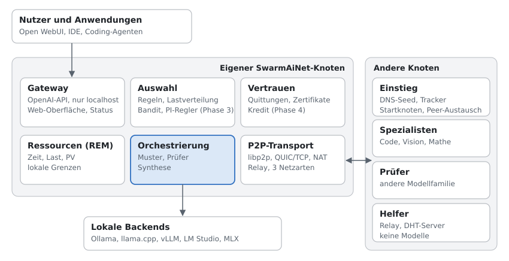
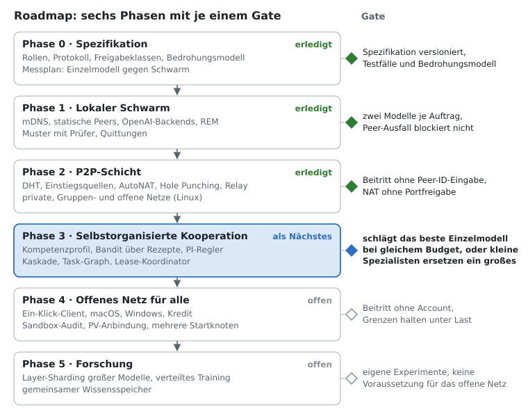

# SwarmAiNet: Gesamtkonzept

[English](../concept.md) · **Deutsch**

**Fassung 2 vom 18.11.2026.** Projekt und Domain heißen **Ai-Swarms.net**, die Software **SwarmAiNet** (Programm `swarmainet`). Die erste Fassung vom 14.10.2026 trug noch den Arbeitstitel „KI-Schwarm“ und liegt im [Archiv](../archive/concept-2026-10-14-de.pdf). Sie führte ein Claude- und ein GPT-5-Konzept zusammen und entschied die Punkte, in denen sie sich widersprachen. Diese Fassung bringt das Konzept auf den Stand von Spezifikation und Umsetzung; was sich gegenüber der ersten Fassung geändert hat, steht am Ende ([Änderungen](#änderungen-gegenüber-fassung-1)). Verbindlich im Detail ist die [Spezifikation](../../spec/de/README.md).

SwarmAiNet ist ein selbstverwaltetes P2P-Netz, in dem unterschiedliche lokale KI-Modelle pro Aufgabe ein Team bilden, sich gegenseitig prüfen und so bessere Ergebnisse liefern sollen als das beste Einzelmodell. Es verbindet zuerst die eigenen Geräte, dann Gruppen und Firmen und schließlich beliebige Teilnehmer mit eingeschränkten Rechten. Der Mehrwert gegenüber dem besten Einzelmodell wird nicht vorausgesetzt, sondern gemessen.

## Entscheidungen

| Frage | Entscheidung | Begründung |
|---|---|---|
| Netzarten | **Drei Netzarten:** privates Netz (PSK), Gruppennetz (Zertifikat je Knoten), offenes Netz; ein Knoten kann mehreren angehören | Eigene Geräte, Gruppen und Fremde brauchen verschiedenes Vertrauen; Priorität in dieser Reihenfolge |
| Automatische Portfreigabe (UPnP/NAT-PMP/PCP) | **Opt-in**, standardmäßig aus | Verändert Router-Einstellungen; IPv6, Hole Punching und Relay decken den Normalfall ohne Freigabe ab |
| Relay für andere anbieten | im offenen Netz **automatisch**, sobald der Knoten öffentlich erreichbar ist, mit sparsamen Grenzen und abschaltbar; in privaten und Gruppennetzen über eigene Helfer | Ohne Relays bei erreichbaren Knoten zerfällt das offene Netz in Inseln, sobald der Startknoten wegfällt; Inhalte bleiben Ende-zu-Ende verschlüsselt |
| Fremde Aufträge annehmen | **Opt-in** (`accept_public_tasks: false` als Standard) | Haftung und DSGVO: Der Nutzer entscheidet bewusst, ob und welche fremden Prompts verarbeitet werden |
| Werkzeuge für fremde Modelle | **Liste je Netz** (`allowed_tools`); im offenen Netz und in Gruppennetzen ohne Liste keine | Werkzeuge führt die Anwendung des Auftraggebers aus; ein Modell, das sie sieht, kann ihren Aufruf auslösen |
| Mitgliedschaft in Gruppen | **Zertifikate ohne Zertifizierungsstelle**: Wurzelschlüssel offline, Aussteller, Rollen `member` und `helper`, Widerruf einzeln | Mitglieder einzeln aufnehmen und entfernen; ein Helfer trägt das Netz, ohne Aufträge zu sehen |
| Einstieg ins offene Netz | **DNS-Seed** `seed.ai-swarms.net`, Startknoten, Tracker, Einladung; danach Peer-Austausch und DHT | Einstiegsknoten lassen sich austauschen, ohne die Software neu auszuliefern |
| PV-Steuerung | **Start/Stopp über Schwellen mit Hysterese**; PI-Regler nur bei mehreren Slots oder verfügbarem Power-Limit | Bei einem Slot ist ein PI-Regler überdimensioniert; Schwellen sind leichter zu verstehen und zu testen |
| Implementierungssprache | **Go mit go-libp2p**; Protokoll bleibt sprachunabhängig | go-libp2p ist die Referenzimplementierung; eine zweite Implementierung (z. B. Rust) folgt für Interoperabilitätstests |
| GPU-Grenze | **Parallel-Jobs, GPU-Minuten, mittlere Auslastung über ein Zeitfenster, Zusatzleistung, Temperatur** statt einer Momentan-Prozentzahl | Einzelne Kernels erreichen kurzzeitig 100 %; eine Momentangrenze ist nicht einhaltbar |
| Suche nach Fähigkeiten | **Eigenes Indexschema** über der DHT: Verweise je Fähigkeit auf mehrere Schlüssel verteilt | Eine Standard-DHT filtert nicht nach kombinierten Fähigkeiten; beliebte Tags überlasten sonst einzelne Knoten |
| Koordination eines Auftrags | **Anfragender Peer koordiniert**; Übergabe per Lease bei Ausfall ab Phase 3 | Keine Zentrale, aber auch kein Verlust laufender Aufträge |
| Anreize | **Keine Pflichtwährung**; signierte Quittungen seit Phase 1, gegenseitiger Kredit ab Phase 4 | Erst messen, dann abrechnen; die Daten für den Kredit liegen dann schon vor |

**Offen:** Ein neu eingerichteter Knoten ohne Einladung tritt heute dem offenen Netz bei. Er nimmt dort nichts an und gibt nichts weiter, ist aber mit Peer-ID und Adresse sichtbar. Die erste Fassung sah die Teilnahme als Opt-in vor. Ob der Standard so bleibt, ist zu entscheiden ([Offene Fragen](#offene-fragen-und-verwandte-projekte)).

## Vision und Leitprinzipien

Nicht möglichst viele Tokens von einem Modell, sondern die beste Kombination geeigneter, unterschiedlicher Modelle. Ein Code-Modell, ein Mathe-Modell, ein Vision-Modell und ein kleiner Klassifikator auf verschiedenen Heimrechnern ergänzen sich; Modelle verschiedener Familien machen unterschiedliche Fehler und können sich gegenseitig kontrollieren.

Von BitTorrent übernommen werden unabhängige Peers, verteilte Suche, freiwilliger Ressourcentausch und Ausfallsicherheit. Nicht übernommen wird die Annahme, Aufträge seien austauschbare Chunks: Eine Antwort braucht passende Kompetenz, Kontext und Prüfung.

| Prinzip | Konsequenz |
|---|---|
| Vom Eigenen zum Offenen | Zuerst die eigenen Geräte, dann Gruppen, dann alle; jede Netzart mit ihrem eigenen Vertrauen und eigenen Rechten |
| Modellagnostisch | Keine Festlegung auf Modellfamilie, Quantisierung, Modalität oder Backend |
| Selbstorganisiert | Discovery, Auswahl, Reputation und Abrechnung laufen verteilt; globales Verhalten entsteht aus lokalen Regeln |
| Keine Zentrale | Keine Accounts, keine zentralen Modelllisten, kein Zahlungsdienst, kein dauerhafter Koordinator; Startknoten und Tracker sind nur Starthilfe |
| Souveräne Knoten | Jeder Knoten entscheidet selbst, wem er vertraut, was er annimmt und wie viel Hardware er abgibt |
| Minimaler Datenzugriff | Ein Peer erhält nur den Kontext, den seine Teilaufgabe braucht |
| Nachvollziehbar | Ergebnisse tragen Herkunft, Evidenz, Unsicherheit und beteiligte Rollen |
| Offene Standards | Versionierte Spezifikation, mindestens zwei Implementierungen, Fork als letzter Ausweg |

**Nicht versprochen:** Geheimhaltung auf fremden Rechnern, Korrektheit von Mehrheitsantworten, vollständige Sybil-Resistenz, grenzenlose Echtzeit-Skalierung.

## Netzarten

| | Privates Netz | Gruppennetz | Offenes Netz |
|---|---|---|---|
| Für | eigene Geräte | Gruppen, Vereine, Firmen | alle |
| Zugang | gemeinsamer Schlüssel (PSK) | Zertifikat je Knoten | frei |
| Einzelne entfernen | nein, nur neuer Schlüssel für alle | ja, per Sperrliste in Sekunden | – |
| Vertrauen | alle Mitglieder | zugelassene Mitglieder, nicht Helfer | niemand außer `trusted_peers` |
| Über Standorte hinweg | eigener Helfer | eigener Helfer, der nichts mitliest | fremde Relays und DHT |

Einzelheiten: [Netzarten](networks.md), [P2P-Schicht](../../spec/de/p2p-layer.md), [Mitgliedsnetze](../../spec/de/membership.md).

## Architektur



Der Knoten rechnet nicht selbst: Er nimmt Anfragen über das Gateway an, wählt Muster und Aufwand, verteilt Teilaufträge über libp2p an andere Knoten und nutzt für eigene Inferenz die lokalen Backends. Der Ressourcenmanager (REM) begrenzt, wie viel fremde Arbeit die eigene Hardware übernimmt. DHT, Peer-Austausch, Startknoten und Helfer liefern nur Kontakte und Verweise, keine Steuerung und kein Vertrauen. Die Auswahl folgt heute festen Regeln; Bandit und Regler kommen in Phase 3. Pakete und Module: [Aufbau](architecture.md).

## Fähigkeiten und Kompetenzmessung

Der Schwarm fragt nicht „Wer hat Modell X?“, sondern „Wer kann Aufgabe Y unter Bedingungen Z?“, und er glaubt Selbstauskünften erst, wenn Messungen sie bestätigen.

**Fähigkeitsanzeige:** signiert, mit Ablaufzeit (TTL 5 min), direkt beim Peer abgerufen. Sie nennt Fähigkeiten, Modalitäten, Kontextlänge, Werkzeugfähigkeit, freie Slots und Policy, aber keine Prompts, keine internen IPs und keine Hardware- oder Energiedaten. Sie steckt im signierten Envelope des Protokolls ([Protokoll](../../spec/de/protocol-v0.1.md) § 3, § 4.1):

```json
{
  "peer_id": "<peer-id>",
  "expires_at": "2026-10-14T12:05:00Z",
  "agents": [{ "agent_id": "ollama/qwen2.5-coder:7b", "model_family": "qwen",
               "skills": ["code.python", "code.review"], "modalities": ["text"],
               "context_max": 32768, "strength": 5, "tools": true }],
  "availability": { "slots_now": 1, "windows": [] },
  "policy": { "accepts": ["trusted"], "retention": "no-prompt-storage" }
}
```

**Fähigkeits-Taxonomie:** ein gemeinsames Grundvokabular (`reasoning.math`, `code.<sprache>`, `code.review`, `vision.ocr`, `retrieval.embed`, `domain.engineering` …) plus freie Tags für Neues. Die DHT enthält nur Verweise „Peer X bietet Fähigkeit Y“, je Fähigkeit auf vier Schlüssel verteilt, damit kein Knoten zum Engpass wird ([P2P-Schicht](../../spec/de/p2p-layer.md) § 5).

**Gemessenes Profil** (Phase 3): Jeder Knoten führt für die Agenten, mit denen er arbeitet, einen Kompetenzwert pro Fähigkeit nach Glicko-2. Quellen, nach Gewicht:

1. Objektiv prüfbare Aufgaben: Code mit Tests, Mathe mit exakter Lösung, Extraktion mit Ground Truth.
2. Canary-Aufgaben mit bekannter Lösung.
3. Urteile von Prüfern anderer Familien; Prüfer bekommen eine eigene Bewertung ihrer Treffer- und Fehlalarmquote.
4. Nutzerfeedback zum Endergebnis.

Die Selbstauskunft `strength` dient nur als Startwert. Reputation ist kontextabhängig: Gute C++-Ergebnisse beweisen keine medizinische Kompetenz. Einzelheiten: [Kooperation](../../spec/de/cooperation.md) § 2.

## Rollen und Kooperationsmuster

Rollen sind dynamisch: Derselbe Knoten kann bei einer Aufgabe Spezialist sein und bei der nächsten Prüfer. Grundregel: Ersteller und Prüfer stammen aus verschiedenen Modellfamilien.

| Rolle | Aufgabe | Typisch geeignet |
|---|---|---|
| Router | Anfrage einordnen: direkt beantworten oder im Schwarm bearbeiten | heute Stichwort-Heuristik; später kleines, schnelles Modell, lokal |
| Planer | Aufgabe in Teilaufgaben zerlegen, Task-Graph erstellen | großes Reasoning-Modell, bevorzugt lokal |
| Spezialist | Teilaufgabe in seiner Domäne lösen | Fachmodell |
| Prüfer | Ergebnis prüfen, Tests ausführen, Fehler benennen | Modell anderer Familie, Werkzeug-Knoten |
| Synthesizer | Geprüfte Teilergebnisse zusammenführen, offene Risiken nennen | starker Generalist, bevorzugt lokal |
| Werkzeug-Knoten | Embeddings, Reranking, OCR, Code in Sandbox ausführen | Spezialmodelle, auch schwache Hardware |
| Netzwerkhelfer | Einstieg, DHT-Server, Relay; später Benchmark-Pool speichern | erreichbare Knoten ohne GPU, z. B. ein VPS |

| Muster | Ablauf | Einsatz | Stand |
|---|---|---|---|
| Experten-Routing (`single`) | Anfrage an den besten Spezialisten, bei Ausfall der nächste | kurze, klar zuordenbare Fragen; Aufträge mit Werkzeugen | umgesetzt |
| Entwurf + Prüfer + Synthese (`draft_verify_synthesize`) | Erzeugen, unabhängig prüfen, nur bei Mängeln überarbeiten | Code, Analysen; heutiger Standard | umgesetzt |
| Parallele Vielfalt (`parallel`, `parallel_verify`) | Mehrere Modelle lösen unabhängig, Synthese, optional geprüft | Faktenfragen, schwierige Probleme | umgesetzt |
| Kaskade | Erst günstiges Modell, bei Unsicherheit eskalieren | künftiger Standard für den Großteil der Anfragen | Phase 3 |
| Zerlegen & Verteilen | Task-Graph, Teilaufgaben parallel | mehrteilige Aufgaben, gemischte Modalitäten | Phase 3 |
| Mixture-of-Agents | Antworten schichtweise verbessern | maximale Qualität, Zeit unkritisch | Idee |
| Debatte | Gegenpositionen, Urteil durch Dritte | Abwägungen, Entscheidungen | Idee |
| Mensch im Kreislauf | Mensch gibt kritische Schritte frei | Dateiänderungen, externe Aktionen | heute über die Anwendung (Werkzeugfreigabe) |

Abstimmung schafft keine Wahrheit: Prüfbare Evidenz zählt mehr als Zustimmung, und Prüfer geben ihr Urteil ab, bevor sie andere Urteile sehen.

## Auftragsprotokoll

Jeder Auftrag hat einen Koordinator, harte Grenzen und einen nachvollziehbaren Ergebnisweg. Der Prompt wird nie öffentlich verbreitet, sondern verschlüsselt nur an ausgewählte Anbieter geschickt. Einzelheiten: [Protokoll v0.1](../../spec/de/protocol-v0.1.md).

**Koordination:** Der anfragende Peer koordiniert seinen Auftrag. Ab Phase 3 hält er dafür einen Lease mit Ablaufzeit; ist er nicht mehr erreichbar, übernimmt ein benannter Ersatzkoordinator, sofern Freigabeklasse und Delegationspolitik das erlauben. Planer und Synthesizer laufen bevorzugt lokal, weil nur sie das Gesamtbild sehen.

**Grenzen pro Auftrag:** Task-ID, Deadline, maximale Delegationstiefe, maximale Zahl an Teilaufträgen, Token-Budget, maximale Übertragungsmenge, Freigabeklasse. Delegationen erben gleiche oder strengere Rechte und verbrauchen dasselbe Gesamtbudget.

**Zustände:** `CREATED → DISCOVERING → OFFERED → ACCEPTED → RUNNING → REVIEWING → COMPLETED`, dazu die Endzustände `REJECTED`, `CANCELLED`, `EXPIRED`, `FAILED`. Wiederholungen sind idempotent, damit nichts doppelt ausgeführt oder abgerechnet wird.

| Nachricht | Zweck | Stand |
|---|---|---|
| `CAPABILITY_ANNOUNCE` | Signierte, ablaufende Fähigkeitsanzeige | umgesetzt |
| `TASK_PROPOSE` | Angebot einer Teilaufgabe mit Budget und Freigabeklasse | umgesetzt |
| `TASK_ACCEPT` | Annahme mit kurzlebigem, begrenztem Lease | umgesetzt |
| `TASK_REJECT` | Ablehnung als eigener Endzustand (gegenüber Fassung 1 ergänzt) | umgesetzt |
| `TASK_PROGRESS` | Status oder Token-Stream | umgesetzt |
| `TASK_RESULT` | Ergebnis mit Herkunft und Evidenz | umgesetzt |
| `TASK_CANCEL` | Abbruch und Aufräumen, auch bei Eigenbedarf des Anbieters | umgesetzt |
| `TASK_RECEIPT` | Von beiden Seiten signierte Quittung | umgesetzt |
| `TASK_BID` | Konditionen, freie Kapazität, erwartete Laufzeit | Phase 3 |
| `VERIFY_REQUEST` | Gezielte unabhängige Prüfung | Phase 3 |
| `TRUST_ATTESTATION` | Optionaler, selektiv geteilter Erfahrungsnachweis | zurückgestellt |

Jede Nachricht trägt Protokollversion, Task-ID, Absender, Ablaufzeit, Nonce und Signatur; unbekannte optionale Felder führen nicht zum Abbruch. Die Protokolle heißen `/swarmainet/<name>/<version>`, etwa `/swarmainet/task/0.1`.

**Ergebnisobjekt:** trennt Antwort, Evidenz, Einschränkungen und Konfidenz. Selbst gemeldete Konfidenz ist keine kalibrierte Wahrscheinlichkeit; ein Hash belegt die Unverändertheit eines Artefakts, nicht seine Richtigkeit. Bei Aufträgen mit Werkzeugen enthält es zusätzlich die Werkzeug-Aufrufe des Modells.

```json
{
  "task_id": "<id>",
  "producer_peer": "<peer-id>",
  "role": "verifier",
  "result": { "status": "partial", "summary": "Zwei Tests schlagen fehl" },
  "evidence": [{ "type": "test-report", "digest": "sha256:<digest>" }],
  "confidence": { "value": 0.6, "kind": "self-reported" },
  "limitations": ["Nur unter Linux getestet"]
}
```

## Auswahl und Regelung

Heute wählt der Orchestrator nach Regeln: Fähigkeit, bei Gleichstand Lastverteilung, Prüfer nach Familie und Modellstärke. Ab Phase 3 entscheidet ein Bandit, welche Modellkombination arbeitet, und PI-Regler entscheiden, wie viel Aufwand eingesetzt wird. Die Auswahl ist eine diskrete Entscheidung und daher keine Aufgabe für einen PID-Regler. Einzelheiten: [Kooperation](../../spec/de/cooperation.md).

**Auswahl (Bandit über Rezepte):** Bewertet werden nicht alle Modellkombinationen, sondern Rezepte aus Muster und Rollenbesetzung, z. B. „Coder-Familie A + Prüfer anderer Familie“. Zuerst gelten harte Filter: Modalität, Freigabeklasse, Verfügbarkeit, Lizenz, erlaubte Werkzeuge. Unter den übrigen wählt Thompson Sampling pro Aufgabenkategorie das günstigste Rezept, das den Qualitäts-Sollwert voraussichtlich erreicht. Ein kleiner Anteil geht an neue Agenten (Exploration); Vielfalt der Modellfamilien wird bei Prüfungen bewusst bevorzugt.

**Regelkreise im Knoten:**

| Regelkreis | Ist | Soll | Stellgröße |
|---|---|---|---|
| Qualität (außen) | gefilterte Erfolgsquote: Tests, Prüferurteil, Feedback | aufgabenabhängig, z. B. 90 % | Aufwandsbudget: Zahl der Modelle, Prüfrunden |
| Kaskade | Fehlerquote der günstigen Stufe | z. B. ≤ 5 % | Konfidenzschwelle für Eskalation |
| Latenz | p90-Antwortzeit | z. B. 20 s | Parallelität, Fallback-Timeout |
| Eigene Last | Schwarmlast auf der eigenen Hardware | strengste Grenze der Ressourcen-Policy | angenommene Jobs, Slots |

**Regelungsregeln:**

- PI statt PID: Die Qualitätsmessung ist verrauscht und kommt mit Totzeit; ein D-Anteil würde vor allem Rauschen verstärken.
- Messgröße mit EWMA glätten, Totband gegen ständiges Nachstellen.
- Anti-Windup: In der Begrenzung wird nicht weiter integriert, auch wenn Peers „nicht verfügbar“ melden.
- Eigene Regler pro Aufgabenkategorie, sonst regelt der Regler nur den Aufgabenmix.
- Die Stellgröße wird auf ganze Zahlen abgebildet, mit Hysterese und Abklingzeit.
- Der Qualitätsregler kann die lokale Ressourcen-Policy anderer Knoten nie überstimmen.
- Gegen Schwingungen im Netz: kleine Verstärkungen, Zufallsjitter, AIMD wie bei der TCP-Staukontrolle.

```math
u_k = u_0 + K_p e_k + K_i \sum_{j \le k} e_j \Delta t, \qquad e_k = q^{*} - \bar{q}_k
```

## Vertrauen, Anreize und Sybil-Schutz

Es gibt keinen globalen Reputationswert und keine Währung: Jeder Knoten bildet sich sein eigenes Urteil und führt seine eigenen Konten.

**Vertrauen je Netzart:** Im privaten Netz sind alle Mitglieder vertraut; im Gruppennetz die zugelassenen Mitglieder mit Rolle `member` oder `issuer`, nicht die Helfer; im offenen Netz nur ausdrücklich eingetragene `trusted_peers`. Gruppennetze brauchen keine Zertifizierungsstelle: Die Netzkennung leitet sich aus dem Wurzelschlüssel ab, Aussteller stellen Zertifikate aus, und Sperrlisten verbreiten sich in Sekunden ([Mitgliedsnetze](../../spec/de/membership.md)).

**Subjektives, transitives Vertrauen** (offenes Netz, ab Phase 3): Jeder berechnet Vertrauen aus eigenen Erfahrungen und den Bewertungen von Peers, denen er vertraut. Startpunkt sind eigene Erfahrungen und optional selbst gewählte Bekannte oder Gemeinschaften, keine global vorgegebenen Vertrauensanker. Ringe, die sich gegenseitig hoch bewerten, haben so keinen Einfluss, solange niemand ihnen vertraut, dem ich vertraue.

```math
T(\text{ich} \to X) = \alpha \, E(\text{ich}, X) + \beta \sum_{Y} T(\text{ich} \to Y) \, T(Y \to X)
```

**Anreize, gestaffelt:**

1. Seit Phase 1: Jede Leistung erzeugt eine von beiden Seiten signierte Quittung; noch keine Verrechnung.
2. Ab Phase 4: Gegenseitiger Kredit. Jeder Knoten führt ein Konto pro Peer mit Kreditlimit, das mit der Historie wächst; transitive Verrechnung über Dritte.
3. Optimistic Unchoking wie bei BitTorrent: Ein kleiner Kapazitätsanteil geht zufällig an Neulinge, damit jeder einsteigen kann.
4. Vergütung nach Beitrag statt nach Tokens: Basis für Rechenaufwand, Qualitätsbonus für übernommene Ergebnisse, Seltenheitsbonus für gefragte, selten angebotene Fähigkeiten. Zutreffende Prüfer und Relay-Betreiber werden ebenfalls vergütet.

Eine Blockchain ist nicht nötig: kein globaler Kontostand, kein Konsens, keine Spekulation.

**Sybil-Schutz ohne Zentrale:** Identitäten kosten nichts, also muss Vertrauen etwas kosten.

- Neue Identitäten leisten zuerst nützliche, prüfbare Arbeit (Proof of Useful Work: Canary-Aufgaben, Prüfungen ausführen).
- Kleine Kreditlimits und unkritische Aufgaben für neue Knoten.
- Optionale Bürgschaft: Ein vertrauter Peer haftet mit einem Teil seiner Reputation.
- Kritische Prüfungen gehen an Prüfer aus verschiedenen Vertrauensclustern.
- Keine sicherheitskritische Entscheidung allein auf Basis von Peer-Stimmen.

**Benchmarks ohne Prüfinstanz:** Jeder kann Aufgaben mit Lösung in einen inhaltsadressierten Pool einbringen. Commit-Reveal verhindert Auswendiglernen: Erst wird der Hash veröffentlicht, die Lösung nach Nutzung. Aufgaben rotieren; falsche Aufgaben senken die Reputation des Einreichers.

**Moderation ohne Zensor:** Jeder Knoten legt seine eigene Content-Policy fest. Gemeinschaften pflegen Filter- und Sperrlisten, die man freiwillig abonniert. Rechtlich verantwortlich ist jeder Betreiber für seinen Knoten.

## Ressourcen- und Energiesouveränität

Ein lokaler Ressourcen- und Energiemanager (REM) lässt fremde Aufträge nur innerhalb der Grenzen zu, die der Betreiber setzt; kein Koordinator und kein Regler kann ihn überstimmen. Eigene Nutzung hat immer Vorrang.

| Dimension | Einstellbar | Durchsetzung | Stand |
|---|---|---|---|
| Hardware | Parallel-Jobs, mittlere GPU-Auslastung über ein Zeitfenster, RAM-Reserve, VRAM-Budget, Zusatzleistung in W, Temperaturgrenze | Zulassungskontrolle, Slots, Abbrechen | umgesetzt bis auf VRAM-Budget und Zusatzleistung; GPU-Messung über `nvidia-smi` |
| Zeit | Zeitfenster pro Wochentag, GPU-Minuten pro Tag, manuelle Pause | Zeitplan, Laufzeitzähler, Leases mit Ablaufzeit | umgesetzt; Pause gilt bis zum Neustart |
| Energie | PV-Überschuss, Mindest-Ladestand des Hausakkus, optional Strompreisgrenze | lokale Messwerte, Schwellen mit Hysterese, sicherer Rückfall | umgesetzt über Home Assistant; MQTT und Modbus/SunSpec folgen |

Sind mehrere Grenzen aktiv, gilt die strengste. Eine Momentangrenze wie „GPU max. 70 %“ wird nicht verwendet, weil einzelne Kernels kurzzeitig 100 % erreichen.

**PV-Modus:** Start und Stopp über Schwellen mit Hysterese, Mindestlaufzeit und Abklingzeit. Maßgeblich ist die Zusatzleistung durch den Schwarmjob, nicht die Gesamtleistung des Rechners. Ein PI-Regler auf die Netzleistung kommt nur dazu, wenn mehrere Slots oder ein GPU-Power-Limit stufenlos gestellt werden können.

```
freigabe_W = max(0, einspeisung_W − reserve_W)
starten,   wenn freigabe_W ≥ start_above_W für start_stable_s
auslaufen, wenn freigabe_W < stop_below_W für stop_stable_s
```

- Veraltete oder fehlende Messwerte: standardmäßig keine neuen Jobs.
- Inselanlage: anderer Messpunkt oder ein Energie-Budgetmodell, da keine Einspeisung messbar ist.
- Anbindung an Wechselrichter, Smart Meter oder Energiemanagement nur lesend.
- Laufende Jobs enden sauber oder werden abgebrochen, wenn der Eigenbedarf es verlangt.

**Was ins Netz geht:** nur kurzlebige Angaben wie freie Slots. Hausverbrauch, Erzeugung, Tarif, Akkustand und der Grund der Verfügbarkeit bleiben lokal. Zeitunkritische Aufträge lassen sich so gezielt in angekündigte Fenster legen; im Netz insgesamt wandert die Last mit der Sonne.

Auszug aus [`config.example.yaml`](../../config.example.yaml):

```yaml
resources:
  prioritize_own_use: true
  accept_public_tasks: false        # Opt-in
  hardware:
    max_parallel_jobs: 1
    gpu_util_mean_max: 60           # % gemittelt über gpu_window_s
    gpu_window_s: 120
    ram_reserve_gib: 16
    vram_budget_gib: 24
    extra_power_max_w: 180
    temperature_stop_c: 85
  schedule:
    windows:
      - { days: [mon, tue, wed, thu, fri], from: "22:00", to: "07:00" }
      - { days: [sat, sun], from: "00:00", to: "24:00" }
    gpu_minutes_per_day: 180
  energy:
    mode: off                       # pv_preferred | pv_only | price_only | off
    source: home_assistant
    reserve_w: 150
    start_above_w: 500
    start_stable_s: 300
    stop_below_w: 250
    stop_stable_s: 120
    battery_soc_min: 50
    price_max_eur_kwh: 0.18
    stale_readings: no_new_jobs
```

## Datenschutz und Sicherheit

Transportverschlüsselung schützt den Weg, nicht den Inhalt vor dem ausführenden Peer: Wer einen Prompt verarbeitet, kann ihn lesen. Ein offenes Netz ist nicht automatisch ein vertrauenswürdiges Netz.

| Freigabeklasse | Verarbeitung |
|---|---|
| Nur lokal (`local`) | ausschließlich auf eigenen Geräten |
| Vertrauter Kreis (`trusted`) | im privaten Netz, bei zugelassenen Mitgliedern eines Gruppennetzes oder bei selbst freigegebenen Schlüsseln |
| Reduziert (`reduced`) | nur minimierte, pseudonymisierte Fragmente (Pseudonymisierung noch offen, bis dahin wie `trusted`) |
| Öffentlich (`public`) | nach expliziter Freigabe auf beliebigen Peers |

Keine personenbezogenen Daten in öffentliche Aufträge. Confidential Computing (TEE) bleibt eine spätere Option, kein Versprechen. Einzelheiten: [Freigabeklassen](../../spec/de/privacy-classes.md).

**Werkzeuge:** Coding-Agenten und Open WebUI geben Modellen Werkzeuge mit. Ausgeführt werden sie von der Anwendung auf dem eigenen Rechner, nicht vom Modell; jedes Ergebnis geht aber an das Modell zurück. Deshalb sieht ein fremdes Modell nur die Werkzeuge, die das jeweilige Netz freigibt, und Aufrufe nicht gezeigter Werkzeuge werden verworfen. Auf Hardware im offenen Netz bestätigt.

**Prompt-Injection zwischen Modellen:** Ergebnisse anderer Peers sind immer Daten, nie Anweisungen. Strukturierte Ausgaben (JSON-Schema) statt Freitext, wo möglich; Planer und Synthesizer laufen lokal; Ergebnisse mit Anweisungsmustern werden verworfen.

**Schutz des eigenen Knotens:**

- Gateway, Inferenz-Backend und Verwaltung lauschen nur auf `localhost`.
- Keine Shell-, Datei-, Browser- oder Netzwerkrechte für fremde Aufträge.
- Fremder Code läuft künftig in einer WebAssembly-Sandbox ohne Netz- und Dateizugriff, unter Linux zusätzlich im Container (Phase 4).
- Größen-, Raten-, Zeit- und Bandbreitenlimits pro Peer; Replay-Schutz über Nonces und Ablaufzeiten.
- Sofort-Stopp: laufende Fremdjobs abbrechen, keine weiteren Annahmen.

| Angriff | Gegenmaßnahme |
|---|---|
| Trittbrettfahrer | Kreditlimits, Tit-for-Tat, begrenztes Optimistic Unchoking |
| Sybil | Proof of Useful Work, erarbeitetes Vertrauen, Bürgschaften |
| Eclipse | viele Einstiegsquellen, Vielfalt in Peer-Cache und Routing-Tabelle, vertraute Peers fest merken |
| Gefälschte Ergebnisse | Prüfer anderer Familien, Canary-Aufgaben, Stichproben |
| Bewertungs-Kartelle | subjektives Vertrauen, objektive Prüfungen vor Meinungen |
| Benchmark-Manipulation | Commit-Reveal, Rotation, Reputation der Einreicher |
| DHT-Vergiftung, Spam | keine frei beschreibbaren DHT-Werte, Verweise nur auf sich selbst, signierte Fähigkeiten direkt beim Peer, Ratenlimits |
| Übernommener Helfer, ausgeschiedenes Mitglied | Gruppennetz: Rolle `helper` ohne Aufträge, Widerruf einzeln |
| Untergeschobene Werkzeug-Aufrufe | Werkzeugliste je Netz, nicht gezeigte Aufrufe verwerfen |
| Datenabgriff | Freigabeklassen, Fragmentierung, sensible Teile lokal |

Vollständig: [Bedrohungsmodell](../../spec/de/threat-model.md).

## Plattform, Erreichbarkeit und Netzeintritt

Der Knoten ist ein einzelnes Go-Programm; er funktioniert im Normalfall ohne Router-Einstellung, und der Nutzer muss keine Peer-ID kennen.

**Plattform:** Der Knoten rechnet nicht selbst, sondern spricht vorhandene Backends über eine OpenAI-kompatible Schnittstelle an: Ollama, llama.cpp, vLLM, LM Studio, MLX. Nur der Knoten muss portabel sein, nicht die GPU-Ansteuerung.

- Heute: Linux, gebaut aus den Quellen; Dienst über systemd, Container-Image für Helfer. macOS und Windows sind nicht geprüft.
- Ziel (Phase 4): Release-Matrix `linux/amd64`, `linux/arm64`, `darwin/arm64`, `darwin/amd64`, `windows/amd64`, `windows/arm64`; Hintergrunddienst über systemd, launchd und Windows-Dienst; Verteilung als .deb/.rpm/AppImage, Homebrew, signiertes MSI/winget; signierte, abschaltbare Updates.
- Bedienung über eine lokale Web-Oberfläche und `swarmainet status`; Hardware-Messung heute über `nvidia-smi`, später ROCm SMI und macOS-Schnittstellen.

**Identität und Erreichbarkeit sind getrennt:** Die Peer-ID wird lokal aus einem Schlüsselpaar erzeugt und bleibt bei IP-Wechsel gleich; jedes Netz bekommt standardmäßig eine eigene. Die aktuellen Adressen veröffentlicht der Knoten selbst; feste IP und DynDNS sind nicht nötig. Nach außen geht nur der P2P-Port, nie der Port des Backends.

**Verbindungsweg, automatisch in dieser Reihenfolge:**

1. Direkt über QUIC/TCP, bevorzugt per öffentlicher IPv6-Adresse.
2. Im eigenen LAN direkt, gefunden per mDNS.
3. AutoNAT prüft die Erreichbarkeit; Hole Punching (DCUtR) baut über ein Relay eine direkte Verbindung auf. Auf Hardware über IPv6/QUIC zwischen Heimnetz und Mobilfunk bestätigt.
4. Relay als Rückfall, mit Zeit-, Daten- und Verbindungsbudget. Für Text reicht das gut, weil Prompts und Tokens nur wenige Kilobyte groß sind.
5. Klappt nichts: klar „nicht verbunden“ melden und eine Diagnose anbieten (`swarmainet ping`).

| Situation | Was ist zu tun? |
|---|---|
| Heimrouter mit NAT | nichts; Hole Punching oder Relay |
| Öffentliche IPv6 | eingehenden P2P-Port in der Router-Firewall freigeben, sonst Relay |
| DS-Lite / CGNAT | IPv4-Portfreigabe hilft nicht; IPv6-Freigabe oder Relay |
| Firmennetz | freigegebener ausgehender Kanal, künftig WebSocket/WebTransport über Port 443; keine Umgehung von Richtlinien |
| Mehrere Knoten im LAN | mDNS; nur die lokale Firewall muss die Verbindung erlauben |
| Automatische Portfreigabe gewünscht | `port_mapping: true` (UPnP/NAT-PMP, Opt-in) |

**Netzeintritt:** Die Software probiert parallel bzw. der Reihe nach:

1. Peer-Cache: zuletzt funktionierende Peers, ab dem zweiten Start die Hauptquelle.
2. mDNS im eigenen LAN.
3. Einladung als Link oder QR-Code mit Netz-Kennung und Adressen; für private Netze mit Schlüssel, für Gruppennetze mit Einmal-Token.
4. Einstiegsadressen und Tracker.
5. DNS-Seeds als aktualisierbarer Hinweis, nie als Vertrauensnachweis; im offenen Netz eingebaut `seed.ai-swarms.net`.
6. Manuell eingetragene Adressen (`static_peers`).

Einstiegsknoten werden erneut angewählt, solange ein Knoten keine Peers, keine DHT-Partner oder hinter NAT keinen Relay-Platz hat; so findet ein Netz nach dem Ausfall eines Startknotens von selbst wieder zusammen. Fallen alle Einstiegsquellen aus, arbeiten bekannte Knoten über den Peer-Cache weiter; nur neue Knoten brauchen dann eine Einladung.

**Erster Start:** Schlüssel erzeugen → Modelle eintragen → Erreichbarkeit klären → ersten Kontakt herstellen → DHT-Routing-Tabelle füllen → Adressen und Fähigkeitsverweise veröffentlichen (nur wenn Bereitstellung aktiviert) → später Neulingsphase mit Canary-Aufgaben.

Eigene Protokollnamen (`/swarmainet/…`) und ein eigenes DHT-Präfix trennen den Schwarm von anderen libp2p-Netzen; private Netze und Gruppennetze nutzen dieselbe Software mit eigener Netz-Kennung.

## Messung und Erfolgskriterien

Der Schwarm gilt erst als Erfolg, wenn er bei gleichem Budget eine höhere geprüfte Qualität liefert als der beste Einzelknoten und als ein fester Multi-Modell-Ablauf, oder zuverlässig erkennt, dass ein Einzelmodell genügt.

| Kennzahl | Vergleich |
|---|---|
| Erfolgsquote | Schwarm gegen bestes verfügbares Einzelmodell |
| Geprüfte Korrektheit | Anteil nachprüfbar belegter, korrekter Aussagen |
| Fehlerkorrelation | Wiederholen unabhängige Modelle dieselben Fehler? |
| Qualität pro Aufwand | Mehrwert pro GPU-Sekunde, Token, Joule und Euro |
| Latenz | Zeit bis zur brauchbaren Endantwort |
| Ausfallsicherheit | Ergebnis trotz Peer-Abbruch und schlechter Verbindung |
| Vielfalt | Bringt ein zusätzlicher andersartiger Peer messbar etwas? |
| Regelungsstabilität | Schwingt der Aufwand, oder pendelt er sich ein? |
| Datenschutz-Exposition | Welche Daten gingen an welche Identitäten? |
| Teilnahmehürde | Zeit und Schritte bis zur ersten Bereitstellung |

**Versuchsaufbau:** Aufgaben getrennt nach Code, Mathematik, Faktenprüfung, multimodaler Analyse und offener Planung, jeweils 30 bis 100 Stück, blind bewertet und mit reproduzierbaren Tests ([Messplan](../../spec/de/measurement-plan.md)).

1. Drei heterogene Modelle lösen alle Aufgaben einzeln.
2. Der Schwarm löst sie mit festem Ablauf (Entwurf + Prüfer + Synthese).
3. Ein PI-Regler passt die Zahl der Prüfungen dynamisch an.
4. Mehrere unabhängige Koordinatoren im P2P-Netz, mit Ausfalltests und simulierten manipulierten Bewertungen.

**Stand:** Runde 1 (80 Aufgaben aus HumanEval und GSM8K) zeigte einen Deckeneffekt: Das beste Einzelmodell löst 79 von 80, der Schwarm schadet kaum, kostet aber das 3- bis 8-Fache an Tokens. Runde 2 braucht schwerere Aufgaben und mindestens drei Modellfamilien ohne Modellwechsel ([Bericht](../../bench/de/report-r1.md)).

## Roadmap



Die P2P-Schicht wurde in Phase 2 robust gemacht, bevor in Phase 3 die Schwarmintelligenz dazukommt; beides gleichzeitig zu debuggen wäre eine Falle. Phase 2 umfasst dabei schon das offene Netz mit einem öffentlichen Startknoten, weil es dieselbe Technik nutzt und sich nur so auf Hardware prüfen ließ. Geöffnet und beworben wird es für alle aber erst in Phase 4. Das Gate von Phase 3 ist die Kernhypothese: Erfüllt der Schwarm es nicht, wird vor Phase 4 das Konzept überarbeitet. Stand im Einzelnen: [Stand der Entwicklung](status.md).

## Offene Fragen und verwandte Projekte

- **Standard beim ersten Start:** Soll ein neuer Knoten ohne Einladung automatisch dem offenen Netz beitreten (heute) oder lokal bleiben, bis das offene Netz bewusst eingeschaltet wird (Fassung 1)?
- **Verfügbarkeit der Aussteller:** Mitglieder verlängern ihr Zertifikat nur, wenn ein Aussteller gleichzeitig online ist. Braucht ein Gruppennetz einen dauerhaft laufenden Aussteller, etwa auf einem Server?
- Wie stark darf automatische Pseudonymisierung den fachlichen Kontext verändern?
- Dürfen neben Ergebnissen auch lokale Wissensindizes (RAG) geteilt werden? Standard: nein.
- Ab wann lohnt ein zusätzlicher Peer aus Qualitätsgründen und nicht nur wegen Kapazität?
- Wie werden Sollwerte und Reglerparameter pro Aufgabenkategorie kalibriert?
- Welche Modelllizenzen erlauben das Anbieten als Dienst für Dritte?
- Was bedeutet Inferenz für Unbekannte rechtlich für Betreiber in Deutschland?

**Verwandte Projekte** (Stand vor Entscheidungen prüfen): Petals und exo (verteilte Ausführung eines Modells), Hivemind (dezentrales Training), AI Horde (Crowdsourcing mit Kudos), Bittensor (gegenseitig bewertende Modelle mit Token-Anreiz), Forschung zu Mixture-of-Agents, LLM-Routing und Multi-Agent-Debatte.

## Änderungen gegenüber Fassung 1

| Thema | Fassung 1 (14.10.2026) | Fassung 2 (18.11.2026) |
|---|---|---|
| Name | KI-Schwarm, Protokoll `/ki-schwarm/…` | SwarmAiNet, Projekt und Domain Ai-Swarms.net, Protokoll `/swarmainet/…` |
| Netzarten | offenes Netz und private Schwärme | drei Netzarten mit Priorität: privat, Gruppe, offen; Gruppennetze mit Zertifikaten neu |
| Relay | Opt-in | im offenen Netz automatisch bei öffentlicher Erreichbarkeit |
| Teilnahme am offenen Netz | Opt-in | heute Standard ohne Einladung; als offene Frage geführt |
| Werkzeuge | „nur nach Zustimmung, mit engen Rechten und Audit-Log“ | Werkzeugliste je Netz, Ausführung durch die Anwendung; Audit-Log nicht umgesetzt |
| Gossip | DHT und Gossip | kein Gossip in Phase 2; Fähigkeiten direkt beim Peer, Verweise in der DHT |
| Einstieg | Bootstrap-Liste, DNS-Seeds | dazu Tracker und QR-Code; erneutes Anwählen nach Ausfall des Startknotens |
| Protokoll | ohne Ablehnungsnachricht | `TASK_REJECT` ergänzt |
| Konfiguration | deutsche Schlüssel (`ressourcen`, `vorrang_eigene_nutzung` …) | englische Schlüssel (`resources`, `prioritize_own_use` …) |
| Befehl | `swarm status` | `swarmainet status` |
| Roadmap | „Das offene Netz kommt erst, wenn der Schwarm das beste Einzelmodell schlägt“ | offenes Netz technisch in Phase 2, für alle geöffnet erst in Phase 4; Stand je Phase in der Grafik |
| Kooperationsmuster | Kaskade als Standard, MoA, Debatte, Mensch im Kreislauf | Stand je Muster ausgewiesen; Kaskade und Task-Graph in Phase 3 |
