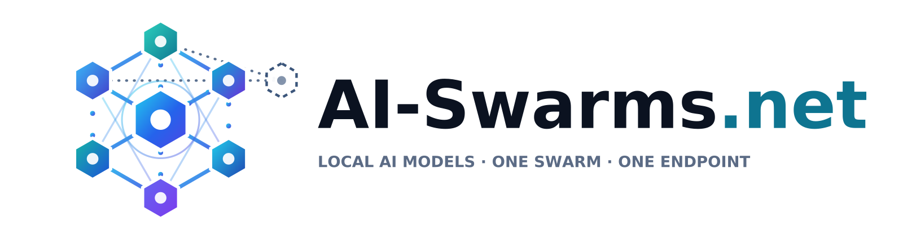
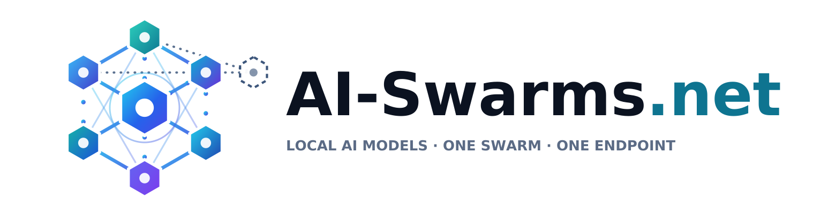

# Logos

**English** · [Deutsch](de/README.md)

Logo package of AI-Swarms.net: SVG masters, PNG previews, favicons and the scripts that generate them.

<picture>
  <source media="(prefers-color-scheme: dark)" srcset="png/ai-swarms-net-dark.png">
  
</picture>

## Folders

| Folder | Contents |
|---|---|
| `svg/` | Masters (vector). The wordmark is stored as path outlines, so no font is needed to display it. |
| `png/` | Previews and the files for GitHub, which does not render SVG from raw URLs |
| `favicon/` | Browser icons 16, 32, 48, 64, 128, 320 and 512 px, `apple-touch-icon-180.png`, `favicon.svg` |
| `scripts/` | Generator scripts, see [below](#regenerating) |

## Files

| File | Size | Use |
|---|---|---|
| `ai-swarms-net-light.svg` / `.png` | 1518 × 420, PNG 1600 × 443 | Logo on white: README, documentation, website |
| `ai-swarms-net-dark.svg` / `.png` | 1518 × 420, PNG 1600 × 443 | Inverse variant on navy `#0B1220` |
| `ai-swarms-net-light-icon.svg` / `.png` | 440 × 440, PNG 600 × 600 | Emblem with the joining peer: avatars, start page of the documentation |
| `ai-swarms-net-dark-icon.svg` / `.png` | 440 × 440, PNG 600 × 600 | The same on navy |
| `ai-swarms-net-light-icon-min.svg` / `.png` | 440 × 440, PNG 600 × 600 | Reduced emblem for small sizes: GitHub avatar, social card, favicon |
| `ai-swarms-net-dark-icon-min.svg` / `.png` | 440 × 440, PNG 600 × 600 | The same on navy |
| `ai-swarms-net-emblem-transparent.svg` / `.png` | 440 × 440, PNG 600 × 600 | Emblem without background, for pages that switch between light and dark |
| `ai-swarms-net-emblem-transparent-darkbg.svg` | 440 × 440 | The same shape with an outline colour for dark backgrounds |
| `favicon/favicon.svg` | 440 × 440 | Same as `ai-swarms-net-light-icon-min.svg` |
| `favicon/favicon-{16,32,48,64,128,320,512}.png`, `favicon/apple-touch-icon-180.png` | as named | Browser and home screen icons, rendered from the reduced emblem |

## Motif

A larger node in the centre is the coordinating model. Six peer nodes form a hexagon, fully meshed by a star from the hub, a ring and chords: the swarm. Small dots on the links are data packets. The node outside on the right is drawn only as a dashed outline: a peer that is joining the network. The reduced emblem leaves out the chords, the data packets and the joining peer, so that it stays legible at 16 to 48 px.

## Colours

| Name | Value | Use |
|---|---|---|
| Navy | `#0B1220` | Dark background, wordmark on light background |
| Teal | `#0E7490` | Ending `.net` on light background (`#22D3EE` on dark) |
| Swarm | gradient `#22D3EE` (cyan) → `#4F46E5` (indigo) | Links and nodes |
| Subtle | `#5B6B85` | Tagline on light background (`#93A4C3` on dark) |

## Usage

**README on GitHub:** use the PNG files. GitHub shows the README in the reader's light or dark theme; `<picture>` picks the matching variant (paths relative to the repository root):

```html
<picture>
  <source media="(prefers-color-scheme: dark)" srcset="logos/png/ai-swarms-net-dark.png">
  
</picture>
```

Centred with a tagline:

```html
<div align="center">
  
  <br>
  <em>Local AI models form a team — one OpenAI-compatible endpoint for your swarm.</em>
</div>
```

**Documentation sites** (e.g. MkDocs), relative to the page:

```md
{ width=420 }
```

**Favicon** on a website that serves the `favicon/` folder:

```html
<link rel="icon" sizes="any" href="/favicon/favicon.svg" type="image/svg+xml">
<link rel="icon" type="image/png" sizes="32x32" href="/favicon/favicon-32.png">
<link rel="apple-touch-icon" sizes="180x180" href="/favicon/apple-touch-icon-180.png">
```

## Regenerating

Requirements: Python 3, `fontTools` and `cairosvg` (`pip install fontTools cairosvg`), and the font DejaVu Sans Bold at `/usr/share/fonts/truetype/dejavu/DejaVuSans-Bold.ttf` (Debian/Ubuntu: package `fonts-dejavu-core`).

```sh
cd logos/scripts
python3 make_logo.py       # light and dark lockups, light and dark icons (SVG)
python3 make_icon_min.py   # light and dark reduced emblems (SVG), favicon PNGs
```

The scripts write their output next to themselves (`logos/scripts/`, favicons to `logos/scripts/favicon/`); copy the files into `svg/` and `favicon/` afterwards. They do not produce the transparent emblem variants or `favicon/favicon.svg` (a copy of `ai-swarms-net-light-icon-min.svg`). The PNG previews in `png/` are rendered with `cairosvg`, 1600 px wide for the lockups and 600 px for the emblems; other renderers (e.g. Inkscape) draw the data packets differently:

```sh
python3 -c "import cairosvg; cairosvg.svg2png(url='svg/ai-swarms-net-light.svg', write_to='png/ai-swarms-net-light.png', output_width=1600)"
```

Colours and dimensions are set at the top of `make_logo.py`.

## License

The logos and graphics are licensed under [CC BY 4.0](../LICENSE-DOCS), like the documentation; the scripts in `scripts/` are code under the [AGPL-3.0-or-later](../LICENSE). See [LICENSING.md](../LICENSING.md).

The wordmark uses DejaVu Sans Bold, embedded as path outlines. The DejaVu fonts are under the Bitstream Vera licence with public-domain changes, which permits this use; no font file is part of the repository.
