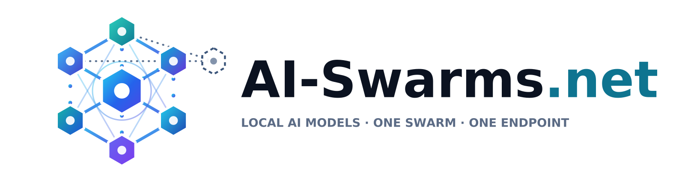

# Logos

[English](../README.md) · **Deutsch**

Logo-Paket von AI-Swarms.net: SVG-Vorlagen, PNG-Vorschauen, Favicons und die Skripte, die sie erzeugen.

<picture>
  <source media="(prefers-color-scheme: dark)" srcset="../png/ai-swarms-net-dark.png">
  
</picture>

## Ordner

| Ordner | Inhalt |
|---|---|
| `svg/` | Vorlagen (Vektor). Die Wortmarke ist als Pfad-Outline gespeichert, zum Anzeigen braucht es keine Schrift. |
| `png/` | Vorschauen und die Dateien für GitHub, das SVG aus Raw-URLs nicht darstellt |
| `favicon/` | Browser-Icons 16, 32, 48, 64, 128, 320 und 512 px, `apple-touch-icon-180.png`, `favicon.svg` |
| `scripts/` | Erzeugerskripte, siehe [unten](#neu-erzeugen) |

## Dateien

| Datei | Größe | Einsatz |
|---|---|---|
| `ai-swarms-net-light.svg` / `.png` | 1518 × 420, PNG 1600 × 443 | Logo auf Weiß: README, Dokumentation, Website |
| `ai-swarms-net-dark.svg` / `.png` | 1518 × 420, PNG 1600 × 443 | inverse Variante auf Navy `#0B1220` |
| `ai-swarms-net-light-icon.svg` / `.png` | 440 × 440, PNG 600 × 600 | Emblem mit beitretendem Peer: Avatare, Startseite der Dokumentation |
| `ai-swarms-net-dark-icon.svg` / `.png` | 440 × 440, PNG 600 × 600 | dasselbe auf Navy |
| `ai-swarms-net-light-icon-min.svg` / `.png` | 440 × 440, PNG 600 × 600 | reduziertes Emblem für kleine Größen: GitHub-Avatar, Social Card, Favicon |
| `ai-swarms-net-dark-icon-min.svg` / `.png` | 440 × 440, PNG 600 × 600 | dasselbe auf Navy |
| `ai-swarms-net-emblem-transparent.svg` / `.png` | 440 × 440, PNG 600 × 600 | Emblem ohne Hintergrund, für Seiten mit Wechsel zwischen hell und dunkel |
| `ai-swarms-net-emblem-transparent-darkbg.svg` | 440 × 440 | dieselbe Form mit Randfarbe für dunkle Flächen |
| `favicon/favicon.svg` | 440 × 440 | gleich `ai-swarms-net-light-icon-min.svg` |
| `favicon/favicon-{16,32,48,64,128,320,512}.png`, `favicon/apple-touch-icon-180.png` | wie benannt | Browser- und Homescreen-Icons, aus dem reduzierten Emblem gerendert |

## Motiv

Ein größerer Knoten in der Mitte ist das koordinierende Modell. Sechs Peer-Knoten bilden ein Sechseck, voll vermascht über einen Stern vom Hub, einen Ring und Sehnen: der Schwarm. Kleine Punkte auf den Verbindungen sind Datenpakete. Der Knoten außen rechts ist nur als gestrichelte Kontur gezeichnet: ein Peer, der dem Netz beitritt. Das reduzierte Emblem lässt Sehnen, Datenpakete und den beitretenden Peer weg, damit es bei 16 bis 48 px lesbar bleibt.

## Farben

| Name | Wert | Einsatz |
|---|---|---|
| Navy | `#0B1220` | dunkler Hintergrund, Wortmarke auf hellem Hintergrund |
| Teal | `#0E7490` | Endung `.net` auf hellem Hintergrund (`#22D3EE` auf dunklem) |
| Schwarm | Verlauf `#22D3EE` (Cyan) → `#4F46E5` (Indigo) | Verbindungen und Knoten |
| Subtle | `#5B6B85` | Unterzeile auf hellem Hintergrund (`#93A4C3` auf dunklem) |

## Einbindung

**README auf GitHub:** die PNG-Dateien verwenden. GitHub zeigt das README im hellen oder dunklen Theme des Lesers; `<picture>` wählt die passende Variante (Pfade relativ zum Wurzelverzeichnis des Repositorys):

```html
<picture>
  <source media="(prefers-color-scheme: dark)" srcset="logos/png/ai-swarms-net-dark.png">
  
</picture>
```

Zentriert mit Unterzeile:

```html
<div align="center">
  
  <br>
  <em>Local AI models form a team — one OpenAI-compatible endpoint for your swarm.</em>
</div>
```

**Dokumentationsseiten** (z. B. MkDocs), relativ zur Seite:

```md
{ width=420 }
```

**Favicon** auf einer Website, die den Ordner `favicon/` ausliefert:

```html
<link rel="icon" sizes="any" href="/favicon/favicon.svg" type="image/svg+xml">
<link rel="icon" type="image/png" sizes="32x32" href="/favicon/favicon-32.png">
<link rel="apple-touch-icon" sizes="180x180" href="/favicon/apple-touch-icon-180.png">
```

## Neu erzeugen

Voraussetzungen: Python 3, `fontTools` und `cairosvg` (`pip install fontTools cairosvg`) sowie die Schrift DejaVu Sans Bold unter `/usr/share/fonts/truetype/dejavu/DejaVuSans-Bold.ttf` (Debian/Ubuntu: Paket `fonts-dejavu-core`).

```sh
cd logos/scripts
python3 make_logo.py       # Logos hell und dunkel, Icons hell und dunkel (SVG)
python3 make_icon_min.py   # reduzierte Embleme hell und dunkel (SVG), Favicon-PNGs
```

Die Skripte schreiben ihre Ausgabe neben sich (`logos/scripts/`, Favicons nach `logos/scripts/favicon/`); die Dateien danach nach `svg/` und `favicon/` kopieren. Die transparenten Embleme und `favicon/favicon.svg` (eine Kopie von `ai-swarms-net-light-icon-min.svg`) erzeugen sie nicht. Die PNG-Vorschauen in `png/` entstehen mit `cairosvg`, 1600 px breit für die Logos mit Wortmarke und 600 px für die Embleme; andere Renderer (etwa Inkscape) zeichnen die Datenpakete anders:

```sh
python3 -c "import cairosvg; cairosvg.svg2png(url='svg/ai-swarms-net-light.svg', write_to='png/ai-swarms-net-light.png', output_width=1600)"
```

Farben und Maße stehen oben in `make_logo.py`.

## Lizenz

Logos und Grafiken stehen wie die Dokumentation unter [CC BY 4.0](../../LICENSE-DOCS); die Skripte in `scripts/` sind Code unter der [AGPL-3.0-or-later](../../LICENSE). Siehe [LICENSING.md](../../de/LICENSING.md).

Die Wortmarke nutzt DejaVu Sans Bold, als Pfad-Outline eingebettet. Die DejaVu-Schriften stehen unter der Bitstream-Vera-Lizenz mit gemeinfreien Änderungen, die diese Nutzung erlaubt; eine Schriftdatei gehört nicht zum Repository.
